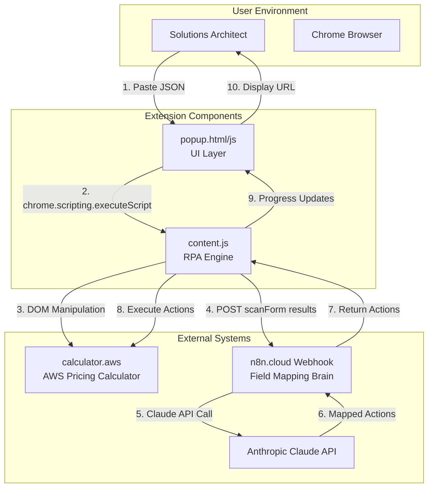

# Architecture Documentation — AWS Calculator RPA Extension

**Document Version**: 1.0  
**Created**: 2026-07-15  
**Project**: AWS Calculator RPA Chrome Extension (v6)

---

## High-Level Architecture

### System Context

---

## Architecture Pattern: RPA (Robotic Process Automation)

The extension acts as a "virtual user" that programmatically interacts with the AWS Pricing Calculator's UI at machine speed with perfect consistency.

---

## Component Architecture

### Layer 1: User Interface (`popup.html` + `popup.js`)

**Responsibility**: Accept user input, orchestrate execution, display results

**Key Elements**:
- Textarea for JSON input
- Progress bar with percentage + text
- Status messages (info/success/error/warning)
- URL display + copy button

### Layer 2: RPA Engine (`content.js`)

**Modules**:
1. **DOM Analysis Engine**: `scanForm()`, `resolveSection()`, `cleanAriaLabel()`
2. **Element Resolver**: `resolveElementByLabel()`
3. **Action Executor**: `executeActions()`, `fillByLabel()`
4. **Flow Orchestrator**: `runRPA()`, `addService()`
5. **Intelligence Interface**: `callN8N()`, `prepareForm()`, `mapFields()`

### Layer 3: External Brain (n8n + Claude)

**Two-Round Interaction**:
- **Ronda 1**: Claude decides which sections to expand
- **Ronda 2**: Claude maps JSON values to form fields

---

## Architecture Decisions & Issues

### Decision 1: External Brain (n8n + Claude)
**Trade-offs**:
- ✅ Flexible, updates without code changes
- ❌ Single point of failure (P1)
- ❌ CORS fragility (P1)

### Known Issues (from REVIVAL_PLAN.md)
- **P1**: Brain location - CORS and downtime risk
- **P2**: Selector resilience - 14 months stale
- **P3**: Silent failures - no error feedback
- **P4**: Repo hygiene - no git, stale permissions

---

## Complete architecture details available in full document.
