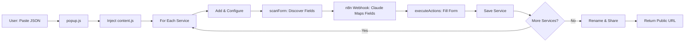

# Business Overview — AWS Calculator RPA Extension

**Document Version**: 1.0  
**Created**: 2026-07-15  
**Project**: AWS Calculator RPA Chrome Extension (v6)

---

## Executive Summary

The AWS Calculator RPA Extension is an internal automation tool at Applying that eliminates manual data entry when creating AWS cost estimates. It transforms a structured JSON specification (from "Skill 3" solution designs) into a shareable public AWS Pricing Calculator URL, reducing estimate creation time from 15-30 minutes to under 2 minutes with zero human interaction.

---

## Business Problem

### Current Pain Points

**Manual Estimate Creation**:
- Solutions architects must manually configure 5-15 AWS services per estimate
- Each service requires navigating AWS Pricing Calculator's multi-step CloudScape UI
- Complex forms with 10-50 fields per service (dropdowns, radios, toggles, instance searches)
- Repetitive data entry prone to human error
- 15-30 minutes per estimate for typical solutions

**Collaboration Friction**:
- Estimates must be shared with clients and internal teams
- Manual sharing process requires navigating share modals
- URL must be copied and distributed manually

**Inconsistency Risk**:
- Different architects may configure services differently
- No standard approach to field mapping
- Hard to reproduce estimates from previous solutions

---

## Solution: RPA Automation

### What It Does

The extension automates the entire AWS Pricing Calculator workflow:

1. **Accept JSON Input**: User pastes a JSON specification from Skill 3 solution designs
2. **Inject RPA Engine**: Content script injected into active calculator.aws tab
3. **Add Services**: For each service in the spec:
   - Search for service by name
   - Configure service with region
   - Apply boolean toggles (enable/disable features)
   - Scan the form to discover all fields
   - Map JSON values to AWS form fields (via Claude AI)
   - Fill all fields automatically
   - Save and return to estimate
4. **Finalize**: Rename estimate, generate public share link, return URL
5. **Visual Feedback**: Spotlight overlay shows RPA progress in real-time

### How It Works (High-Level)

---

## Business Value

### Time Savings
- **Before**: 15-30 minutes per estimate (manual)
- **After**: 1-2 minutes per estimate (automated)
- **ROI**: 90-95% time reduction per estimate

### Accuracy & Consistency
- Eliminates manual data entry errors
- Standardized field mapping via Claude AI
- Reproducible estimates from JSON specifications

### Collaboration Efficiency
- Instant public share URLs
- Copy-paste into client communications
- No manual navigation of share modals

---

## User Personas

### Primary: Solutions Architect
- **Need**: Create AWS cost estimates for client proposals quickly
- **Pain**: Manually filling 50+ fields across multiple services
- **Benefit**: Automate 95% of estimate creation time

### Secondary: Account Manager
- **Need**: Generate estimates for RFPs and client meetings
- **Pain**: Waiting for architects to create estimates
- **Benefit**: Self-service estimate generation from solution specs

---

## Business Transactions

### Transaction 1: Create Calculator Estimate (Primary)

**Trigger**: User has a JSON specification from Skill 3 solution design

**Flow**:
1. User opens calculator.aws in Chrome
2. User clicks extension icon → opens popup
3. User pastes JSON spec into textarea
4. User clicks "⚡ Generar Estimado"
5. Extension injects RPA engine into page
6. For each service in JSON:
   - RPA navigates: Add service → Search → Configure
   - RPA sets region (first service only)
   - RPA applies feature toggles (enable/disable)
   - RPA scans form to discover ~10-50 fields
   - RPA sends fields to Claude (via n8n webhook)
   - Claude returns mapped actions (fill, select, radio, etc.)
   - RPA executes actions to fill all fields
   - RPA clicks Save
7. RPA renames estimate to project name
8. RPA clicks Share → Agree and continue
9. RPA extracts public URL
10. Extension displays URL in popup + copy button

**Success Criteria**:
- All services configured correctly
- Public URL returned
- Zero manual interaction required

**Failure Modes**:
- n8n webhook down → silent failure (no fields filled)
- Selector stale → buttons not found, clicks fail
- CORS error → fetch blocked, no mapping

---

### Transaction 2: ReAct Mode (Future / Planned)

**Trigger**: User wants AI-recommended architecture based on Well-Architected Framework

**Flow**: (Not yet implemented in v6)
1. User enters natural language prompt instead of JSON
2. Claude recommends services and configurations
3. RPA executes recommendations

**Status**: Placeholder mode in requirements, not implemented

---

## Success Metrics

### Functional
- ✅ Success rate: % of estimates that complete without errors
- ✅ Field coverage: % of requested fields successfully filled
- ✅ Time to URL: seconds from "Generate" click to public URL

### Technical
- ✅ n8n uptime: % availability of webhook brain
- ✅ Selector resilience: % of UI updates that don't break RPA
- ✅ CORS reliability: % of fetches that succeed

---

## Current State (v6)

### Strengths
- Sophisticated DOM scanner handles all CloudScape UI patterns
- 9 documented fixes for edge cases (FIX-1 through FIX-9)
- Visual spotlight feedback during RPA execution
- Example JSON loader for quick testing

### Weaknesses (from REVIVAL_PLAN.md)
- **P1**: Brain (Claude mapping) lives in external n8n webhook → CORS fragility, single point of failure
- **P2**: Selectors may be stale after 14 months without AWS UI updates
- **P3**: Failures are silent (no error feedback to user)
- **P4**: No version control, stale manifest permissions

---

## Stakeholders

### Internal (Applying)
- **Solutions Team**: Primary users
- **Sales Team**: Secondary users (RFP responses)
- **IT/DevOps**: Maintainers

### External Dependencies
- **n8n.cloud**: Hosts the Claude mapping webhook
- **AWS**: Pricing Calculator UI (breaking changes affect RPA)
- **Anthropic**: Claude API (powers field mapping intelligence)

---

## Future Enhancements (from Requirements)

1. **ReAct Mode**: Natural language → AI recommendations → RPA execution
2. **Resilient Brain**: Move mapping logic into extension (remove n8n dependency)
3. **Error Surfacing**: Visible error states in popup
4. **Selector Auto-Healing**: Detect and adapt to UI changes
5. **Version Control**: Git repository with proper branching

---

## Business Risk Assessment

### High Risk
- **n8n Dependency**: If webhook goes down, extension is non-functional
- **CORS Fragility**: Fetch from page context can be blocked
- **AWS UI Changes**: CloudScape updates can break selectors

### Medium Risk
- **API Key Exposure**: If moved to direct Claude API calls, key management required
- **Maintenance Burden**: No automated testing, relies on manual verification

### Low Risk
- **User Adoption**: Simple UI, clear value proposition
- **Data Privacy**: No PII, only AWS service configurations

---

## Conclusion

The AWS Calculator RPA Extension delivers significant time savings and consistency improvements for cost estimate creation. The current v6 implementation is functionally complete but has architectural fragilities (external brain dependency, CORS, silent failures) that need to be addressed in the revival effort. The business value is proven; the revival focus should be on reliability and maintainability.
