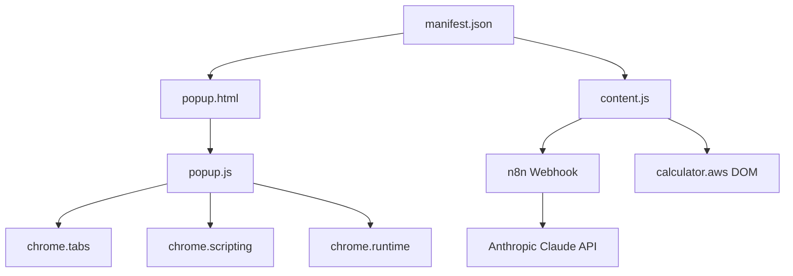

# Component Inventory — AWS Calculator RPA Extension

**Document Version**: 1.0  
**Created**: 2026-07-15  
**Project**: AWS Calculator RPA Chrome Extension (v6)

---

## Component Classification

### Extension Components
1. **Manifest Configuration** — Extension metadata and permissions
2. **Popup UI** — User interface for input and feedback
3. **RPA Engine** — Core automation logic

### External Dependencies
4. **n8n Webhook** — Claude AI field mapping service
5. **AWS Calculator** — Target automation site

---

## 1. Manifest Configuration (`manifest.json`)

### Component ID
- **File**: `manifest.json`
- **Type**: Configuration
- **Lines**: 26
- **Owner**: Extension platform (Chrome)

### Responsibilities
- Define extension metadata (name, version, description)
- Declare required permissions
- Configure host permissions
- Register popup and content scripts
- Set icon assets

### Key Configuration

| Property | Value | Purpose |
|----------|-------|---------|
| `manifest_version` | 3 | Use Manifest V3 API |
| `permissions` | `activeTab`, `scripting`, `clipboardWrite`, `tabs` | Enable Chrome APIs |
| `host_permissions` | `calculator.aws/*`, `dnd5zrqcec4or.cloudfront.net/*` | Allow DOM access |
| `action.default_popup` | `popup.html` | Popup UI |
| `content_scripts` | `content.js` on `calculator.aws/*` | Auto-inject script |

### Issues
- ❌ Missing `https://n8n-retirado.example/*` permission (P4)
- ❌ Stale `dnd5zrqcec4or.cloudfront.net/*` permission (P4)

### Dependencies
- None

---

## 2. Popup UI

### 2.1 Popup Markup (`popup.html`)

**Component ID**: `popup.html`  
**Type**: UI Layer (HTML + CSS)  
**Lines**: 147  
**Owner**: User Interface

#### Responsibilities
- Render extension popup UI
- Provide JSON input textarea
- Display progress bar
- Show status messages (info/success/error/warning)
- Display public estimate URL
- Provide copy-to-clipboard button

#### UI Elements

| Element ID | Type | Purpose |
|------------|------|---------|
| `#json-input` | `<textarea>` | Accept JSON specification |
| `#btn-example` | `<button>` | Load example JSON |
| `#btn-run` | `<button>` | Start RPA execution |
| `#progress` | `<div>` | Progress bar container |
| `#progress-fill` | `<div>` | Progress bar fill |
| `#progress-text` | `<div>` | Progress text |
| `#status` | `<div>` | Status message box |
| `#url-box` | `<div>` | URL display container |
| `#url-link` | `<a>` | Public estimate URL link |
| `#btn-copy` | `<button>` | Copy URL to clipboard |

#### Styling Characteristics
- **Theme**: Dark (`#0f1117` background)
- **Brand**: Applying colors (orange gradient `#FF9900` → `#FF6B00`)
- **Layout**: Flexbox vertical stack
- **Animations**: Button hover, progress bar transition
- **Responsive**: Fixed width 380px

#### Dependencies
- `popup.js` (event handlers)

---

### 2.2 Popup Controller (`popup.js`)

**Component ID**: `popup.js`  
**Type**: UI Controller  
**Lines**: 88  
**Owner**: User Interface

#### Responsibilities
- Handle user interactions (button clicks)
- Parse and validate JSON input
- Orchestrate RPA execution (find/create tab, inject script, send message)
- Display progress updates from content script
- Display results (URL) and errors
- Provide copy-to-clipboard functionality

#### Key Functions

| Function | Lines | Responsibility |
|----------|-------|----------------|
| `setStatus(msg, type)` | 4 | Display status message with color coding |
| `setProgress(pct, text)` | 4 | Update progress bar and text |
| `showURL(url)` | 5 | Display public estimate URL |
| `setRunning(running)` | 3 | Enable/disable "Generate" button |

#### Event Handlers

| Event | Handler | Action |
|-------|---------|--------|
| `#btn-example` click | inline | Load EXAMPLE_JSON into textarea |
| `#btn-copy` click | inline | Copy URL to clipboard, show feedback |
| `#btn-run` click | inline | Validate JSON, inject script, start RPA |

#### Message Handling

**Incoming Messages** (from content.js):

| Message Type | Handler | UI Update |
|--------------|---------|-----------|
| `PROGRESS` | Update progress bar + status | Show % complete + text |
| `DOM_FIELDS` | Log to console (debug) | None (debug only) |
| `DONE` | Show URL, set progress 100% | Display URL box + copy button |
| `ERROR` | Show error status | Red error message |

#### Tab Management Logic

```javascript
// 1. Find existing calculator.aws tab
const tabs = await chrome.tabs.query({ url: 'https://calculator.aws/*' });

// 2. Use existing or create new
let targetTab = tabs.length > 0 ? tabs[0] : await chrome.tabs.create({ url: '...' });

// 3. Inject content.js if not present
try {
  await chrome.tabs.sendMessage(targetTab.id, { type: 'PING' });
} catch {
  await chrome.scripting.executeScript({ target: { tabId }, files: ['content.js'] });
}

// 4. Send RUN_RPA message
await chrome.tabs.sendMessage(targetTab.id, { type: 'RUN_RPA', config });
```

#### Dependencies
- `chrome.tabs` API
- `chrome.scripting` API
- `chrome.runtime` API (message passing)
- `navigator.clipboard` API

---

## 3. RPA Engine (`content.js`)

**Component ID**: `content.js`  
**Type**: RPA Engine  
**Lines**: 1,193  
**Owner**: Automation Logic

### Module Inventory

#### 3.1 Configuration Module

**Lines**: 8-20  
**Exports**: `DELAY`, `N8N_MAPPER_URL`

| Constant | Value | Purpose |
|----------|-------|---------|
| `DELAY.SHORT` | 600ms | After simple actions |
| `DELAY.MEDIUM` | 1200ms | After form changes |
| `DELAY.LONG` | 2500ms | After navigation |
| `N8N_MAPPER_URL` | `https://n8n-retirado.example/webhook/aws-field-mapper` | Claude mapping endpoint |

---

#### 3.2 Utilities Module

**Lines**: 15-56  
**Functions**: 6

| Function | Lines | Purpose | Complexity |
|----------|-------|---------|------------|
| `sleep(ms)` | 1 | Promise-based delay | Trivial |
| `log(msg)` | 1 | Console logging with `[RPA]` prefix | Trivial |
| `getText(el)` | 1 | Extract clean text from element | Low |
| `cleanAriaLabel(raw)` | 23-35 | Strip AWS placeholder contamination | Medium |
| `parseUnitButtonLabel(lbParts)` | 37-56 | Parse CloudScape button labels | Medium |
| `isToggleOn(el)` | 58-73 | Detect checkbox state | Medium |

**Key Capabilities**:
- Text normalization
- ARIA label cleaning (FIX-1)
- CloudScape button label parsing (FIX-2)
- Toggle state detection (aria-checked, class, computed style)

---

#### 3.3 Claude Interface Module

**Lines**: 86-115  
**Functions**: 3

| Function | Purpose | Round | Returns |
|----------|---------|-------|---------|
| `callN8N(payload)` | POST to n8n webhook | Both | Array of actions |
| `prepareForm(service, domFields, requestedValues)` | Get expand actions | 1 | Array of expand actions |
| `mapFields(service, domFields, requestedValues)` | Get fill actions | 2 | Array of fill actions |

**Responsibilities**:
- HTTP POST to n8n webhook
- Handle 3 response formats (direct array, `{actions:[]}`, `{mappedFields:[]}`)
- Error handling and logging

**Network Contract**:
- **Method**: POST
- **Content-Type**: application/json
- **Timeout**: None (relies on fetch default)
- **Error Handling**: Catch, log, return `[]` (silent failure — P3)

---

#### 3.4 Action Executor Module

**Lines**: 117-172  
**Functions**: 1

**`executeActions(actions)`**

**Responsibilities**:
- Dispatch actions to appropriate handlers
- Execute expand, toggle_on, toggle_off actions
- Delegate fill/select/radio/etc to `fillByLabel()`

**Supported Actions**:
- `expand`: Expand collapsed section
- `toggle_on`: Enable feature toggle
- `toggle_off`: Disable feature toggle
- `fill`, `select`, `dropdown`, `radio`, `checkbox`, `instance_search`, `instance_radio`: Fill form fields

**Error Handling**: Try-catch per action, log warning, continue

---

#### 3.5 Wait Utilities Module

**Lines**: 174-219  
**Functions**: 3

| Function | Timeout | Poll Interval | Purpose |
|----------|---------|---------------|---------|
| `waitForButton(text)` | 15s | 200ms | Wait for button to appear |
| `waitForEstimatePage()` | 20s | 300ms | Wait for /estimate page load |
| `waitForText(text)` | 10s | 200ms | Wait for text in DOM |

**Pattern**: Polling loop with timeout, throw on failure

---

#### 3.6 UI Interaction Primitives Module

**Lines**: 221-289  
**Functions**: 5

| Function | Purpose | Complexity |
|----------|---------|------------|
| `findButton(text)` | Find visible button by text | Low |
| `mouseClick(el)` | Dispatch realistic mouse event sequence | Medium |
| `click(el)` | Scroll + mouseClick + delay | Low |
| `fillInput(el, value)` | Fill text/number input (native setter) | Medium |
| `selectNative(el, value)` | Set native select option | Low |

**Key Technique**: `mouseClick()` dispatches full event sequence:
```
mouseover → mouseenter → mousedown → mouseup → click → el.click()
```

---

#### 3.7 Toggle Handler Module

**Lines**: 291-366  
**Functions**: 3

| Function | Purpose | Complexity |
|----------|---------|------------|
| `setToggle(toggleName, wantOn)` | Find and toggle checkbox | High |
| `activateToggle(name)` | Convenience wrapper for ON | Low |
| `deactivateToggle(name)` | Convenience wrapper for OFF | Low |

**Resolution Strategy** (cascading fallback):
1. `label[for]` with exact text match
2. `input[aria-labelledby]` reconstruction (FIX-9)
3. `awsui_native-input` with container text

**Complexity Driver**: 3 fallback strategies + normalization

---

#### 3.8 Section Expander Module

**Lines**: 368-399  
**Functions**: 1

**`expandAllSections()`**

**Responsibilities**:
- Find all collapsed sections (`button[aria-expanded="false"]`)
- Filter out dropdown triggers
- Click all in 5 rounds (handles dynamic sections)

**Fallback Use**: When Claude doesn't specify expand actions in Ronda 1

---

#### 3.9 DOM Scanner Module (CORE)

**Lines**: 401-585  
**Functions**: 1 + 3 helpers

**`scanForm()`** — Universal field scanner

**Returns**: Array of field descriptors (JSON-safe, no DOM references)

**Capabilities**:

| Field Type | Detection Strategy | Lines |
|------------|-------------------|-------|
| Text/Number Input | aria-label, aria-labelledby, compound label splitting | 447-470 |
| Checkbox (Toggle) | aria-labelledby, label[for], container text (FIX-4) | 447-484 |
| Radio (Normal) | Group by name, resolve label (FIX-6) | 486-527 |
| Radio (Instance Table) | Detect tr/role=row, extract row text (FIX-5) | 497-506 |
| Native Select | aria-label, aria-labelledby | 529-545 |
| CloudScape Dropdown | aria-labelledby multi-part parsing (FIX-2) | 547-575 |
| Slider | aria-label, aria-valuenow/min/max | 577-585 |

**Helper Functions**:
- `resolveSection(el)` — Determine field's semantic grouping (FIX-3)
- `isUIChrome(el)` — Exclude header/nav/footer elements
- `splitAriaLabel(raw)` — Separate compound labels ("Section > Value")

**Complexity**: **Very High** (10+ field types, 6 fixes, section resolution)

---

#### 3.10 Element Resolver Module

**Lines**: 587-659  
**Functions**: 1

**`resolveElementByLabel(labelText)`**

**Input**: `"Section > Field Name"` or `"Field Name"`  
**Output**: DOM element or `null`

**Resolution Strategy** (cascading fallback):
1. aria-label exact match (all segments)
2. aria-labelledby reconstruction (FIX-8 for Unit buttons)
3. label[for] by field name
4. Section context disambiguation

**Complexity**: Medium (4 fallback strategies, FIX-8)

---

#### 3.11 CloudScape Dropdown Handler Module

**Lines**: 661-687  
**Functions**: 1

**`selectAwsDropdown(buttonEl, value)`**

**Responsibilities**:
- Click button to open listbox
- Wait for `awsui_option-content` elements (6 attempts)
- Find option by exact or partial text match
- Click `awsui_selectable-item` wrapper

**Returns**: `true` if successful, `false` if option not found

---

#### 3.12 Fill Handler Module

**Lines**: 689-977  
**Functions**: 1

**`fillByLabel(labelText, value, type)`** — Execute single action

**Routing Logic**:

```
if (isInstanceSearch)           → Search input + select row
if (type === 'instance_radio')  → Find row by text, click radio
if (labelText.startsWith('__switch__:')) → setToggle()
else {
  el = resolveElementByLabel(labelText);
  if (el.type === 'radio')      → Find radio in group, click
  if (el.type === 'checkbox')   → Toggle to desired state
  if (el.tagName === 'SELECT')  → selectNative()
  if (el.tagName === 'BUTTON')  → selectAwsDropdown()
  else                          → fillInput()
}
```

**Complexity**: High (8+ action types, special cases)

---

#### 3.13 Service Saver Module

**Lines**: 979-1008  
**Functions**: 1

**`saveService(name)`**

**Responsibilities**:
- Scroll to bottom (buttons are at bottom)
- Find and click Save button (3 retry attempts)
- Try multiple button text variations
- Verify success (URL includes `/estimate` OR `Add service` button found)

**Retry Strategy**: 3 attempts with DELAY.MEDIUM between

---

#### 3.14 Estimate Renamer Module

**Lines**: 1010-1042  
**Functions**: 1

**`renameEstimate(projectName)`**

**Responsibilities**:
- Find and click "Edit" button (with preventDefault)
- Wait for name input to appear
- Fill with projectName
- Click "Save"

**Complexity**: Medium (async waits, input detection)

---

#### 3.15 Share Handler Module

**Lines**: 1044-1070  
**Functions**: 1

**`shareEstimate()`**

**Responsibilities**:
- Click "Share" button
- Click "Agree and continue" (if modal appears)
- Find readonly input with URL
- Optionally click "Copy public link"
- Return URL

**Returns**: Public estimate URL or current page URL (fallback)

---

#### 3.16 Service Flow Orchestrator Module

**Lines**: 1072-1161  
**Functions**: 1

**`addService(svc, isFirstService)`** — Per-service automation

**Flow** (15 steps):
```
1. Navigate to /estimate
2. Click "Add service"
3. Select "Search all services"
4. Search for service by search_term
5. Click "Configure" on correct service card
6. Wait for form load
7. Set region (first service only)
8. Apply __switch__ toggles BEFORE scanForm (FIX-7)
9. scanForm() → extract initial fields
10. prepareForm() → Ronda 1 → get expand actions
11. Execute expand actions (or expandAllSections fallback)
12. scanForm() → extract expanded fields
13. mapFields() → Ronda 2 → get fill actions
14. executeActions() → fill all fields
15. saveService() → save and return to /estimate
```

**Complexity**: **High** (15-step flow, toggle timing FIX-7, region mapping)

**Key Components**:
- **Region Mapping**: 20+ AWS region codes → display names
- **Toggle Timing (FIX-7)**: Apply __switch__ toggles BEFORE first scanForm to ensure conditional fields are visible

---

#### 3.17 RPA Runner Module

**Lines**: 1163-1191  
**Functions**: 1

**`runRPA(config, sendProgress)`** — Main entry point

**Responsibilities**:
- Navigate to /estimate
- For each service: call `addService()`
- Rename estimate
- Share estimate
- Return public URL

**Progress Reporting**: 10% + (75% * i/total) for service progress

**Error Handling**: Catch per service, log, return to /estimate, continue

---

#### 3.18 Message Listener Module

**Lines**: 1193-1210  
**Functions**: Event listener

**Responsibilities**:
- Handle `PING` message (health check)
- Handle `RUN_RPA` message (start automation)

**Message Contract**:
```javascript
{ type: 'PING' }                    → { status: 'OK', url: ... }
{ type: 'RUN_RPA', config: {...} }  → { status: 'started' }
```

---

## 4. External Dependency: n8n Webhook

**Component ID**: n8n workflow  
**Type**: External Service  
**Host**: `https://n8n-retirado.example`  
**Endpoint**: `/webhook/aws-field-mapper`  
**Owner**: n8n cloud (manuelaballen account)

### Responsibilities
- Accept POST requests with domFields + requestedValues
- Call Anthropic Claude API
- Return mapped actions (expand, fill, select, etc.)

### Contract

**Request**:
```json
{
  "round": 1 | 2,
  "service": "AWS Lambda",
  "domFields": [...],
  "requestedValues": {...}
}
```

**Response** (3 formats accepted):
```json
[...]                    // Direct array
{ "actions": [...] }     // Wrapped
{ "mappedFields": [...] }  // Alt wrapped
```

### Issues
- **P1**: Single point of failure
- **P1**: CORS fragility (must return Access-Control-Allow-Origin header)
- **Unknown**: Status, health, API key validity

---

## 5. External Dependency: AWS Pricing Calculator

**Component ID**: calculator.aws  
**Type**: External Website  
**Host**: `https://calculator.aws/`  
**Owner**: AWS

### Responsibilities
- Render pricing calculator UI
- Accept service configurations
- Generate public estimate URLs

### UI Framework: CloudScape Design System
- Custom dropdowns, inputs, sections
- Heavy ARIA usage
- Dynamic DOM updates

### Issues
- **P2**: UI may have changed in 14 months (selector staleness)
- **Localization**: Button text may vary by locale

---

## Component Dependency Graph



---

## Component Complexity Matrix

| Component | LOC | Functions | Complexity | Risk |
|-----------|-----|-----------|------------|------|
| `manifest.json` | 26 | 0 | Low | Low (config only) |
| `popup.html` | 147 | 0 | Low | Low (static UI) |
| `popup.js` | 88 | 4 | Medium | Low (UI logic) |
| `content.js` | 1,193 | 42 | **Very High** | **High** (DOM fragility) |
| n8n Webhook | N/A | N/A | Unknown | **High** (external dependency) |

**Highest Risk**: `content.js` (1,193 lines, 42 functions, 9 documented fixes, selector fragility)

---

## Component Maintenance Status

| Component | Status | Last Updated | Needs Update |
|-----------|--------|--------------|--------------|
| `manifest.json` | Stale | ~14 months | ✅ Yes (P4 — permissions) |
| `popup.html` | Stable | ~14 months | ❌ No |
| `popup.js` | Stable | ~14 months | ❌ No |
| `content.js` | Unknown | ~14 months | ⚠️ Maybe (P2 — selectors) |
| n8n Webhook | Unknown | Unknown | ⚠️ Verify status |

---

## Component Testing Status

| Component | Unit Tests | Integration Tests | Manual Testing |
|-----------|------------|-------------------|----------------|
| `manifest.json` | N/A | N/A | ✅ Load unpacked |
| `popup.html` | N/A | N/A | ✅ Visual inspection |
| `popup.js` | ❌ None | ❌ None | ✅ Click buttons |
| `content.js` | ❌ None | ❌ None | ⚠️ 14 months stale |
| n8n Webhook | ❌ None | ❌ None | ⚠️ Unknown status |

**Testing Gap**: No automated tests at any level

---

## Component Evolution Recommendations

### Immediate (Revival Phase)
1. **Verify n8n Webhook**: Run REVIVAL_PLAN Test C
2. **Update manifest.json**: Fix permissions (P4)
3. **Test content.js Selectors**: Run REVIVAL_PLAN Test B against current AWS UI

### Short-Term
1. **Add Component Tests**: Unit tests for utilities, DOM scanner
2. **Extract Configuration**: Move hardcoded values to config file
3. **Add Logging Module**: Structured logs for debugging

### Long-Term
1. **Refactor content.js**: Split 1,193 lines into ES modules
2. **Remove n8n Dependency**: Migrate to background service worker + Claude API
3. **Add Auto-Healing**: Detect and adapt to selector changes
