# Interaction Diagrams — AWS Calculator RPA Extension

**Document Version**: 1.0  
**Created**: 2026-07-15  
**Project**: AWS Calculator RPA Chrome Extension (v6)

---

## 1. High-Level RPA Flow

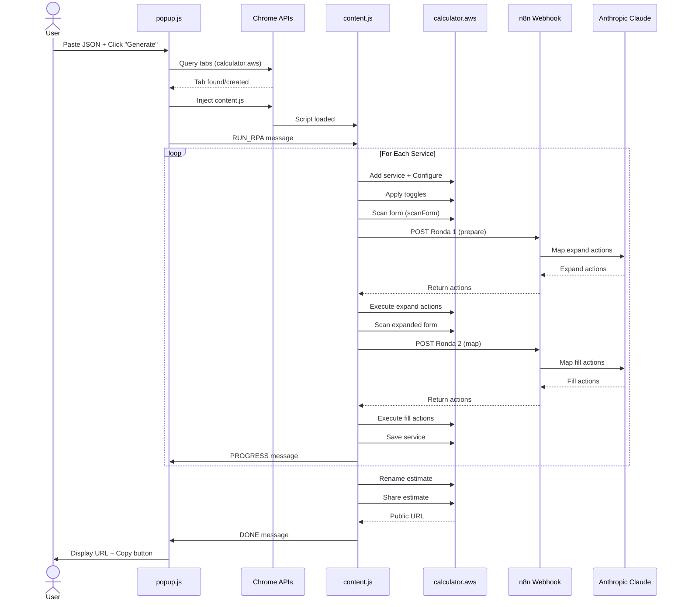

---

## 2. Popup Initialization Flow

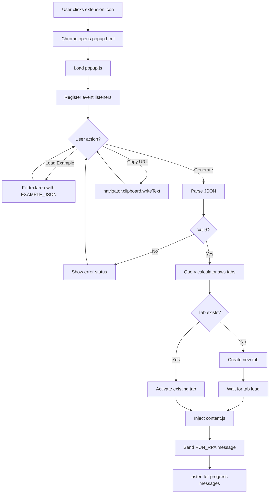

---

## 3. Content Script Injection Flow

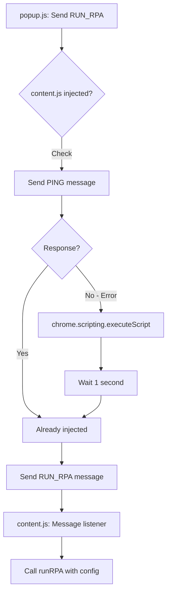

---

## 4. Add Service Flow (Per Service)

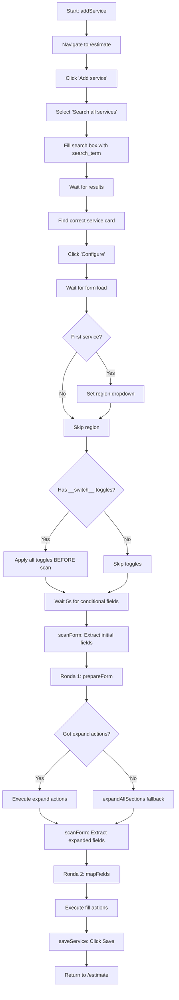

---

## 5. scanForm: DOM Analysis Flow

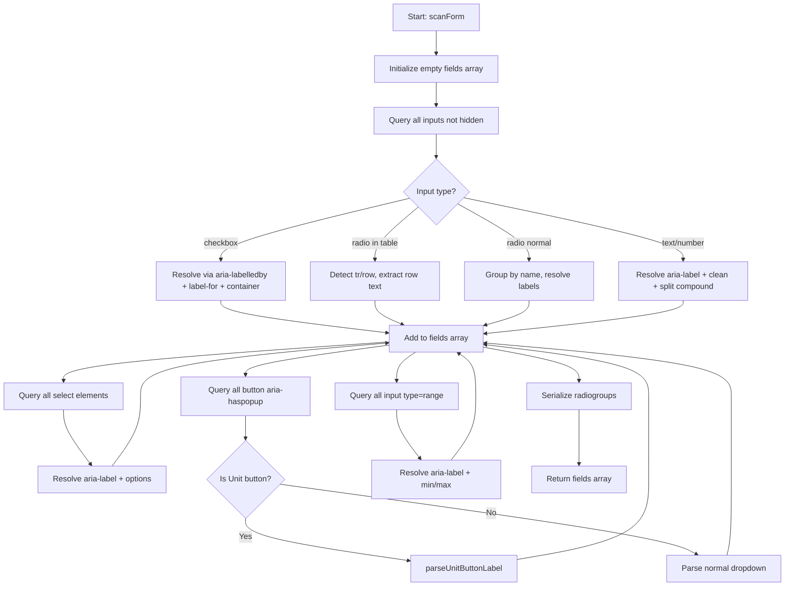

---

## 6. fillByLabel: Action Execution Flow

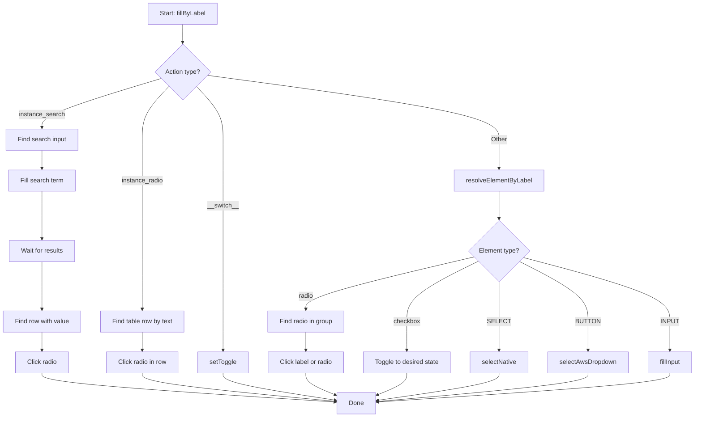

---

## 7. Claude Mapping: Two-Round Interaction

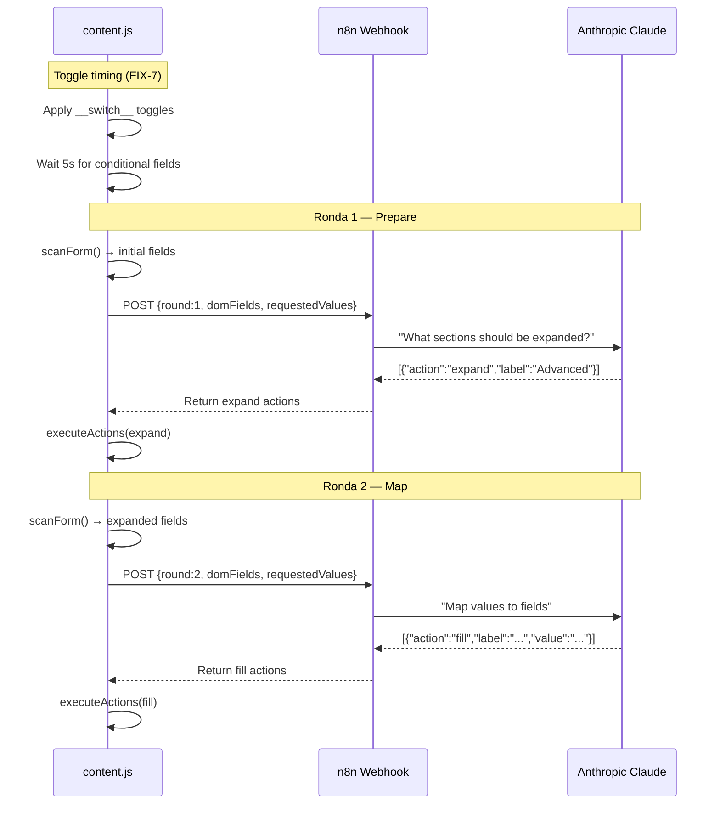

---

## 8. setToggle: Resolution Strategy

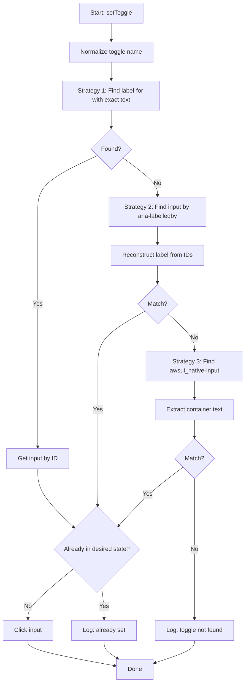

---

## 9. selectAwsDropdown: CloudScape Dropdown Flow

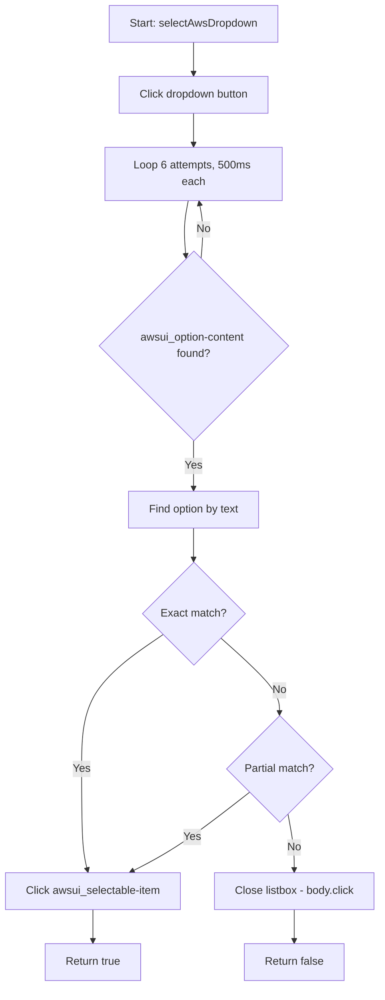

---

## 10. saveService: Retry Strategy

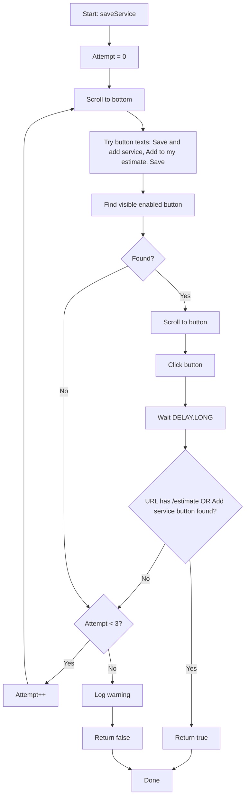

---

## 11. Message Passing Architecture

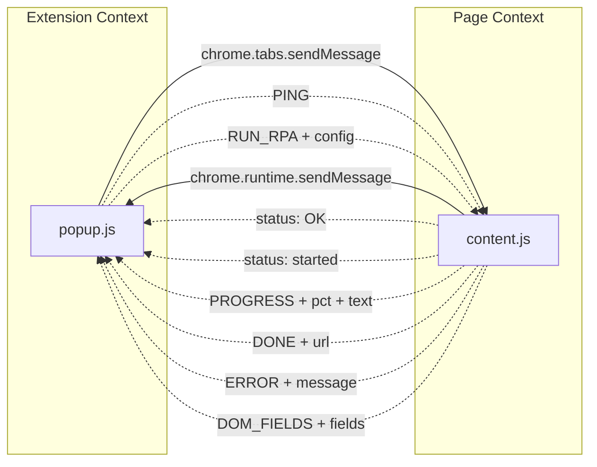

---

## 12. Error Recovery Flow

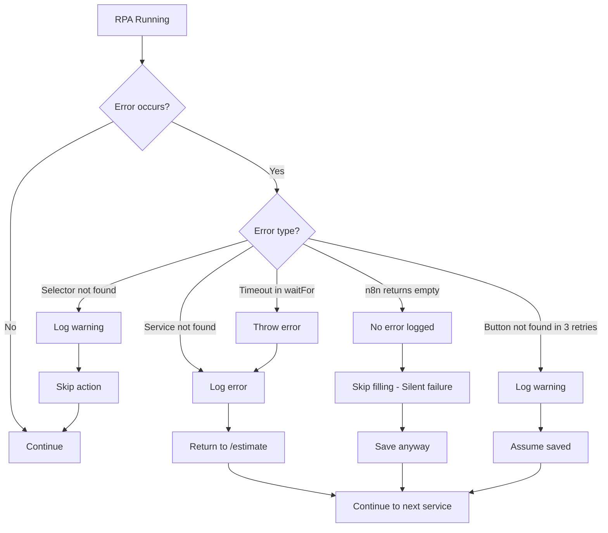

---

## 13. Region Configuration Flow (First Service Only)

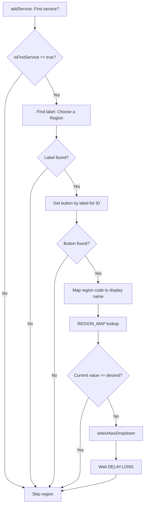

---

## 14. Toggle Timing Fix (FIX-7) Flow

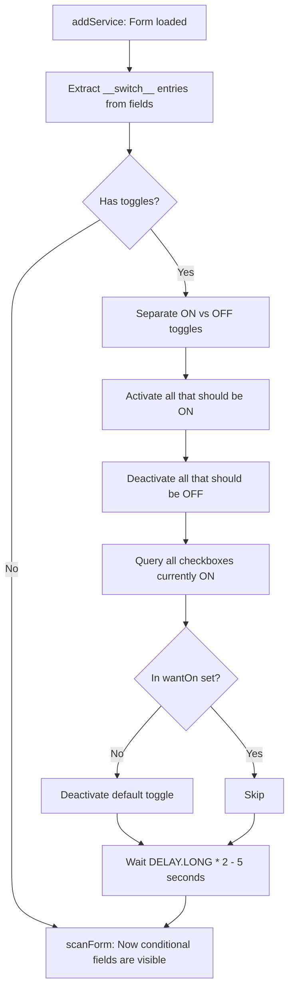

---

## 15. Complete Service Addition Sequence Diagram

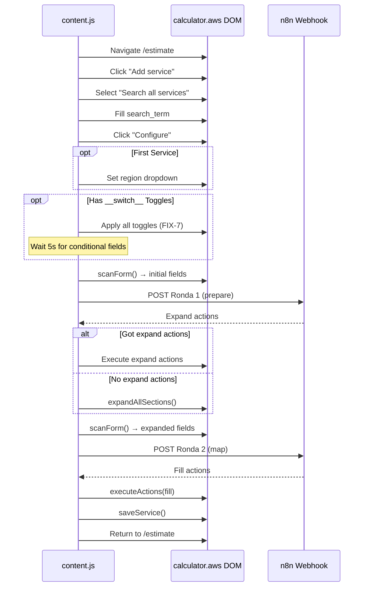

---

## 16. Share Estimate Flow

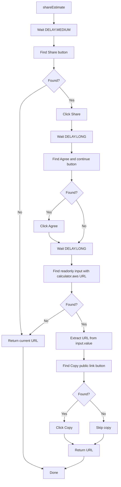

---

## Key Interaction Patterns

### Pattern 1: Poll-and-Wait
Used in: `waitForButton`, `waitForEstimatePage`, `waitForText`
- Poll every 200-300ms
- Timeout after 10-20s
- Throw error on timeout

### Pattern 2: Retry with Fallback
Used in: `saveService`, `resolveElementByLabel`, `setToggle`
- Try primary strategy
- If fails, try alternative
- Log warning, continue

### Pattern 3: Two-Round Intelligence
Used in: Claude mapping
- Round 1: Decide what to expand
- Execute expansions
- Round 2: Map and fill with full context

### Pattern 4: Cascading Resolution
Used in: `resolveElementByLabel`, `setToggle`
- Try most specific strategy first
- Fall back to more general strategies
- Return null if all fail

### Pattern 5: Progressive Enhancement
Used in: `addService` toggle timing
- Apply structural changes first (toggles)
- Wait for DOM to settle
- Then read final state (scanForm)

---

## Timing Characteristics

| Interaction | Typical Duration | Bottleneck |
|-------------|------------------|------------|
| Add service | 8-12s | n8n round-trips (2x) + AWS UI render |
| scanForm | 50-200ms | DOM traversal |
| n8n Ronda 1 | 1-3s | Network + Claude API |
| n8n Ronda 2 | 1-3s | Network + Claude API |
| Fill fields | 2-5s | Delays between actions |
| Save service | 1-3s | Button search + retry |
| Full estimate (5 services) | 60-90s | Total of all services |

---

## Critical Interaction Points (Fragility)

| Interaction | Fragility | Reason |
|-------------|-----------|--------|
| Button text matching | **High** | Localization, AWS UI changes |
| CloudScape selectors | **High** | Class names may change |
| n8n webhook | **High** | External dependency (P1) |
| ARIA attribute parsing | **Medium** | Complex, but stable standard |
| Save button detection | **Medium** | Multiple fallbacks |
| Region name mapping | **Low** | AWS region names stable |
