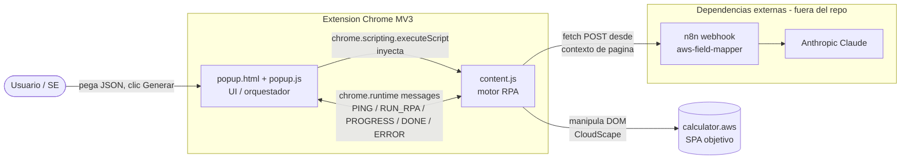
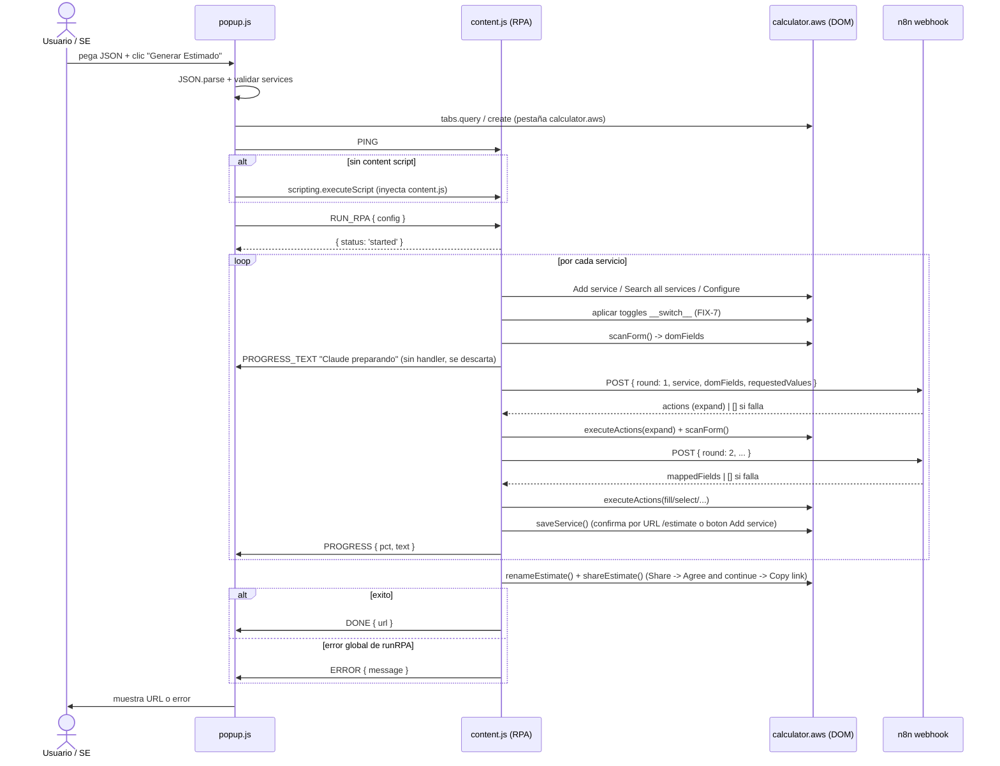

# Architecture — AWS Calculator RPA Extension

## Architecture Analysis

### System Overview

Extensión de Chrome (Manifest V3) que automatiza por RPA el AWS Pricing Calculator (`calculator.aws`). Consta de dos piezas de código que corren en contextos distintos del navegador — un **popup** (UI) y un **content script** (motor RPA inyectado en la página de la calculadora) — más una dependencia de runtime externa: un **"cerebro" de mapeo** alojado en un workflow n8n que, a su vez, invoca a Anthropic Claude. El cerebro NO está versionado en este repo.

La extensión no sirve ningún endpoint HTTP propio; su única salida de red es un `POST` al webhook n8n.

### Architectural Style

**Cliente de navegador basado en eventos / RPA sobre DOM**, no cliente-servidor clásico. Evidencia:

- Sin backend propio ni API servida: la extensión manipula el DOM de una SPA de terceros (CloudScape) porque `calculator.aws` no expone API.
- Dos componentes desacoplados por paso de mensajes (`chrome.runtime` message passing) entre popup y content script.
- La lógica de "inteligencia" (mapeo campo↔valor) está externalizada en un servicio opaco (n8n + Claude) — arquitectura de **cerebro externo**.

**Hallazgo estructural clave: NO hay service worker (background).** El `manifest.json` no declara clave `background` ni existe `background.js`. Todo el `fetch` al cerebro n8n corre desde `content.js`, es decir, **en el contexto de la página `calculator.aws`**. Esta es la raíz técnica de la fragilidad CORS descrita en P1.

### Component Relationships

Texto alternativo: el usuario interactúa con el popup; el popup inyecta `content.js` en la pestaña de `calculator.aws` e intercambia mensajes con él; `content.js` manipula el DOM de la SPA y hace `fetch` al webhook n8n, que delega en Claude. No hay service worker entre el content script y la red.

### Data Flow

1. Usuario pega JSON en el popup y pulsa "Generar Estimado".
2. `popup.js` valida el JSON, localiza/crea la pestaña `calculator.aws`, hace `PING`, inyecta `content.js` si hace falta y envía `RUN_RPA` con la config.
3. `content.js` (`runRPA`) navega a `#/estimate` y, por cada servicio, llama a `addService`: Add service → Search all services → Configure → aplicar toggles (FIX-7) → `scanForm()` → consultar al cerebro n8n (ronda 1 expand, ronda 2 map) → `executeActions()` → `saveService()`.
4. Durante la ejecución `content.js` emite `PROGRESS` (y `PROGRESS_TEXT`) de vuelta al popup.
5. Al terminar, `renameEstimate` + `shareEstimate` producen la URL pública, devuelta como `DONE`; un error global se devuelve como `ERROR`.

### Anomalías de contrato de mensajes (preservar como hallazgos)

Dos desajustes entre lo que `content.js` envía y lo que `popup.js` maneja (ninguno documentado por los docs previos; ambos agravan P3):

- **`PROGRESS_TEXT`** — lo **emite** `content.js` (en `addService`: "🤖 Claude preparando…" / "🤖 Claude configurando…") pero `popup.js` **no tiene handler** → esos avisos se **descartan en silencio**; el usuario no ve que el RPA espera a Claude.
- **`DOM_FIELDS`** — lo **maneja** `popup.js` (logs de debug + status "N campos detectados") pero `content.js` **nunca lo envía** → **handler muerto**.

### Key Design Decisions

Decisión arquitectónica central: **dónde vive el "cerebro" de mapeo campo↔valor** (origen de P1). Estado actual y alternativas con tradeoffs:

- **Estado actual (A): cerebro externo en n8n, invocado por `fetch` desde el content script.**
  - Ventajas: el prompt/lógica de Claude se itera sin re-publicar la extensión; sin secretos en el repo.
  - Desventajas: `fetch` corre en el origen `calculator.aws` sin el host en `host_permissions` → **CORS bloquea** la llamada; punto único de fallo (si n8n cae, `callN8N` devuelve `[]`); dependencia opaca no versionada; estado del webhook **no verificado**.

- **Alternativa B: cerebro externo pero invocado desde un `service worker` (background MV3).**
  - Ventajas: el `fetch` sale del contexto de extensión, no del de la página → **evita el problema CORS** de origen `calculator.aws`; separa red de manipulación de DOM; es exactamente el fix que propone `REVIVAL_PLAN.md`.
  - Desventajas: requiere declarar el host n8n en `host_permissions`; añade una pieza (service worker) y su ciclo de vida; no elimina el punto único de fallo en n8n.
  - Tradeoff: bajo costo estructural, resuelve P1 CORS; sigue dependiendo de n8n.

- **Alternativa C: internalizar el mapeo (reglas/heurísticas por servicio dentro de `content.js`, sin IA externa).**
  - Ventajas: sin dependencia de red ni de CORS; versionado y testeable; sin punto único de fallo externo.
  - Desventajas: pierde la flexibilidad del LLM ante formularios CloudScape heterogéneos; alto costo de mantenimiento por servicio; frágil ante cambios de UI (P2).
  - Tradeoff: máxima robustez de red, mínima adaptabilidad.

Recomendación de reversibilidad: **B** es la opción más reversible y de menor riesgo (mover el `fetch` al service worker + corregir `host_permissions`) y es la vía preferida de `REVIVAL_PLAN.md`; **C** es una apuesta mayor y menos reversible.

### Nota de seguridad / compliance

- **CORS / permisos (P1 + P4):** el host n8n `https://n8n-retirado.example/*` **falta** en `host_permissions`; combinado con la ausencia de service worker, el `fetch` queda sujeto al CORS de `calculator.aws`. Además hay un **host muerto** `https://dnd5zrqcec4or.cloudfront.net/*` no referenciado por ningún código (P4) — ampliación innecesaria de permisos a eliminar.
- **Secretos:** la constraint "no secrets hardcoded" se respeta en el código de la extensión (la URL del webhook no es un secreto; la clave de Claude vive en n8n). El cerebro externo es una superficie de confianza fuera del repo.
- **Principio de mínimo privilegio:** `activeTab` es probablemente inerte dado el modelo real (se opera por `tabs.query` + `host_permissions`); `clipboardWrite` puede ser redundante en MV3 para escritura por gesto de usuario. Ver `technology-stack.md`.

### Improvement Opportunities

- Mover el `fetch` del cerebro a un **service worker** y añadir el host n8n a `host_permissions` (resuelve P1 CORS).
- Eliminar el host muerto `dnd5zrqcec4or.cloudfront.net` (P4).
- Resolver los desajustes `PROGRESS_TEXT` (añadir handler) y `DOM_FIELDS` (eliminar handler muerto o emitir el mensaje) para mejorar visibilidad (P3).
- Surfacear fallos parciales al popup en lugar de degradar en silencio (P3).
- Detectar el banner verde de éxito y los errores de validación obligatoria antes de asumir guardado (gap vs `AWS Calculator UI Flow.md`).

## Interaction Diagrams

Transacción de negocio "Generar estimado desde JSON" (popup → content script → cerebro n8n → DOM → save), implementada a través de los componentes:

Texto alternativo: el popup valida y arranca el RPA; `content.js` itera por servicio manipulando el DOM y consultando dos veces al webhook n8n; los fallos del cerebro devuelven `[]` y degradan en silencio; `PROGRESS_TEXT` se descarta por falta de handler; al final el content script comparte el estimado y devuelve `DONE` con la URL, o `ERROR` si `runRPA` lanza.
