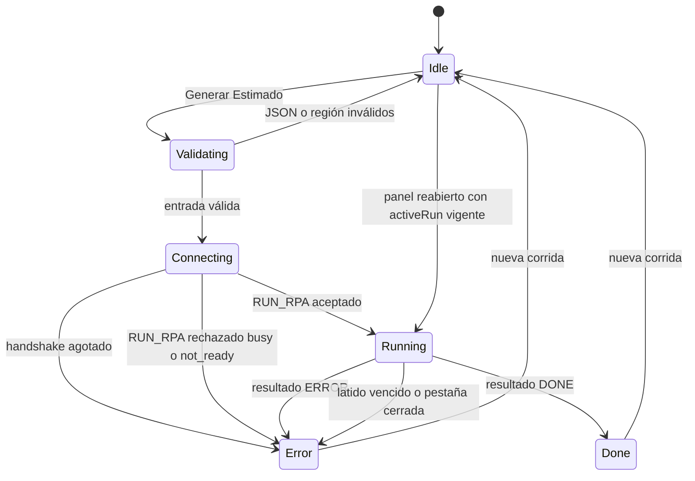
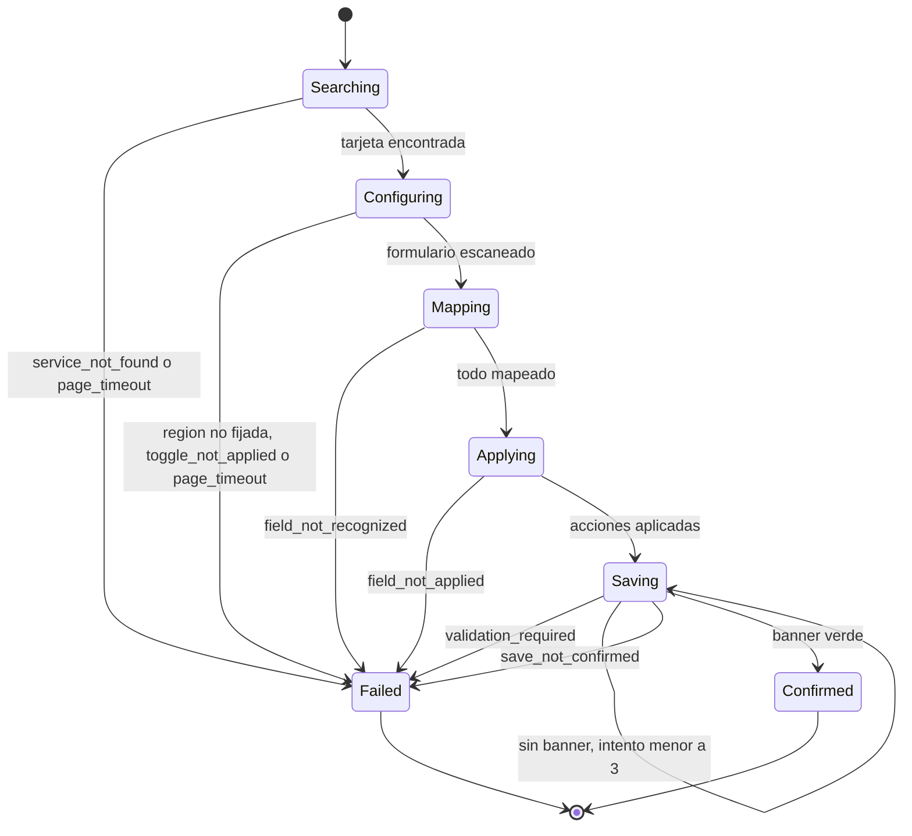
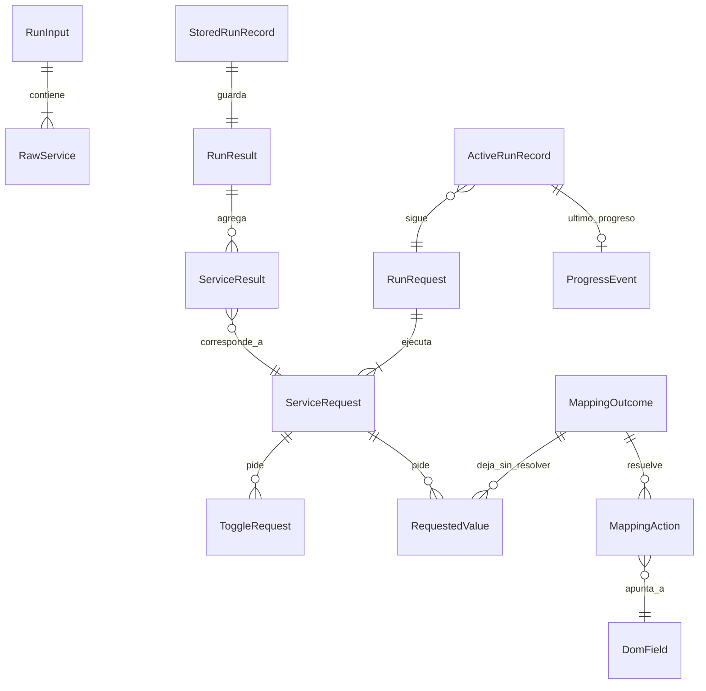

# Especificación funcional — u1-walking-skeleton

> Fuente de verdad de los flujos y máquinas de estado del walking skeleton.
> Datos: `entities.md`; lógica de decisión: `rules.md`. El diagrama ER y el
> resumen de reglas de este documento son vistas derivadas. Prosa en español;
> identificadores, tipos de mensaje y nombres de archivo en inglés.

## Sources

- `aidlc/spaces/default/intents/260922-calculator-rpa/inception/units-generation/unit-of-work.md` (U1: slice mínimo, agnóstico del cerebro, módulos provisionales que U2/U3/U5 reemplazan en sitio). [stage]
- `aidlc/spaces/default/intents/260922-calculator-rpa/inception/units-generation/unit-of-work-story-map.md` (US1.0, US1.1 → U1; orden: handshake → flujo de un servicio → agregación mínima). [stage]
- `aidlc/spaces/default/intents/260922-calculator-rpa/inception/user-stories/stories.md` (US1.0, US1.1 y sus AC). [stories]
- `aidlc/spaces/default/intents/260922-calculator-rpa/inception/requirements-analysis/requirements.md` (FR1.2, FR2, FR3, FR5, FR9, FR10, NFR3, NFR5, NFR7, NFR8; C1-C7; Anexo A). [requirements]
- `aidlc/spaces/default/intents/260922-calculator-rpa/inception/domain-design/components.md` (componentes y dueños de entidades). [stage]
- `aidlc/spaces/default/intents/260922-calculator-rpa/inception/contract-design/contract-summary.md` (interfaces internas `normalize`, `mapDeterministic`, `aggregate`; enums de C1). [stage]
- Código actual: `aws-calculator-extension/popup.js`, `content.js`, `manifest.json` (v6). [brownfield]
- `functional-design-questions.md` de esta unidad, Q1-Q10 y la confirmación del resumen. [Q1-Q10]

## 1. Alcance de la unidad

Esta unidad implementa **US1.0** (alcanzar o abrir la pestaña de `calculator.aws` e inyectar el content script) y **US1.1** (estimado de un servicio desde JSON, el walking skeleton), definidas en `stories.md`.

Entra en el skeleton:
- Entrada **solo JSON** (Anexo A) desde un **panel lateral** del navegador (Q7).
- Handshake con la pestaña: reutilizar o abrir, `PING`, inyectar y reintentar (US1.0).
- Mapeo **determinístico** mínimo por coincidencia única de etiqueta; sin cerebro (U4).
- RPA de un servicio: buscar, configurar, fijar región, aplicar acciones, guardar con confirmación por **banner verde**.
- Agregación todo-o-nada, **renombrado** (bloqueante, Q2), Share y URL pública.
- Persistencia del **último resultado** en `chrome.storage.local` (Q8/Q9).
- Caso canónico **EC2 t3.micro** (Q6/Q10), que adelanta de U5 la búsqueda de instancia y la selección por fila (FIX-5/FIX-6).

Queda fuera (otras unidades o cambio de alcance):
- Entrada en lenguaje natural (U2); mapeo del residuo con el cerebro (U4); FIX-1..FIX-4 y FIX-7..FIX-9, cascada completa de resolución, spotlight (U5).
- Estados completos del panel M1-M8, accesibilidad completa, panel WAF (U6, ahora sobre el panel lateral).
- Manifest de mínimo privilegio definitivo y empaquetado (U7).
- **Agente conversacional con memoria persistente** (chat, contexto, entre sesiones): capacidad nueva, a planificar como cambio de alcance; su memoria vivirá en un backend junto al cerebro (U4) (Q8/Q9).

## 2. Estructura de módulos compartidos

La unidad fija los nombres de módulo que U2/U3/U5/U6 heredan: cada pieza mínima del skeleton vive en el archivo que la unidad dueña completará, marcada como provisional. Todos los módulos de `lib/` son módulos ES sin dependencias del DOM salvo los de `lib/dom/`, de modo que Vitest los importa directamente (Zona A).

| Archivo (bajo `aws-calculator-extension/`) | Contenido en U1 | Dueño final | Zona |
|---|---|---|---|
| `sidepanel.html`, `sidepanel.js` | Panel lateral mínimo: entrada JSON, botón, progreso, resultado, "Última corrida" | U6 | B (smoke) |
| `background.js` | Service worker (módulo): abre el panel lateral al pulsar el icono | U6/U7 | B |
| `content.js` | Script clásico y delgado: guardia de carga única, único listener de mensajes, responde `PING` con `{ ok, ready }` y carga `lib/content-main.js` con `import(chrome.runtime.getURL(...))` (Q3, BR2.5) | U5 | B |
| `lib/content-main.js` | Exporta el manejador de `RUN_RPA` que `content.js` invoca una vez `ready`; arma la corrida con las piezas de abajo | U5 | B |
| `lib/messages.js` | Constantes de tipos de mensaje y forma de cada payload | U1 (compartido) | A |
| `lib/connection/handshake.js` | Lógica de reutilizar/abrir + `PING` + inyectar + reintentar, con la API de Chrome inyectada | U1 | A |
| `lib/input/json-parser.js` | Parseo y validación mínima del Anexo A (BR1.1, BR1.2) | U2 | A |
| `lib/input/input-normalizer.js` | `normalize` → `ServiceRequest[]` (BR1.3, BR1.4) | U2 | A |
| `lib/mapping/deterministic-mapper.js` | `mapDeterministic(domFields, requestedValues)` (BR3.1-BR3.3) | U3 | A |
| `lib/mapping/region-map.js` | Tabla `RegionMap` | U5 | A |
| `lib/rpa/retry.js` | Contador de intentos acotados como función pura (BR2.3, BR4.6) | U5 | A |
| `lib/rpa/result-aggregator.js` | `aggregate(requested, serviceResults)` → veredicto (BR5.1) | U5 | A |
| `lib/rpa/orchestrator.js` | Flujo por servicio sin tocar el DOM; recibe el resolvedor del DOM como dependencia | U5 | A |
| `lib/dom/dom-resolver.js` | `scanForm`, resolución por etiqueta, aplicar acciones, guardar, renombrar, Share, instancias EC2 | U5 | B |

Reglas de carga (Q3):
- El manifest **conserva** `content.js` en `content_scripts` para `https://calculator.aws/*`; la inyección programática solo cubre pestañas abiertas antes de recargar la extensión, y la guardia de carga única de `content.js` evita listeners duplicados (BR2.5).
- `web_accessible_resources` expone `lib/**` **solo** a `https://calculator.aws/*`.
- El manifest añade los permisos `sidePanel` y `storage`, y quita `default_popup` (el icono abre el panel lateral). La limpieza completa de mínimo privilegio (host CloudFront muerto) sigue siendo de U7.
- Ningún módulo usa `eval`, `new Function()` ni scripts remotos (C6).

## 3. Contrato de mensajes

Reemplaza el contrato del v6 (`PROGRESS`, `PROGRESS_TEXT` sin handler, `DOM_FIELDS` muerto, `DONE`, `ERROR`).

| Tipo | Dirección | Payload | Respuesta |
|---|---|---|---|
| `PING` | panel → content | — | `{ ok: true, ready: true }` módulo listo; `{ ok: true, ready: false }` cargando; `{ ok: false, ready: false }` el módulo no cargó (BR2.5) |
| `RUN_RPA` | panel → content | `RunRequest` | `{ accepted: true }`, o `{ accepted: false, reason: "busy" \| "not_ready" }` (BR6.1) |
| `PROGRESS` | content → panel | `ProgressEvent` (también actualiza `activeRun`) | — |
| `RUN_RESULT` | content → panel | `RunResult` (tras guardarlo en `lastRunResult` y borrar `activeRun`) | — |

El panel ignora `PROGRESS` y `RUN_RESULT` cuyo `runId` no coincide con la corrida en curso. Como el mensaje puede perderse si el panel estaba cerrado, la fuente de verdad del final es `chrome.storage.local`: el panel escucha sus cambios (`activeRun`, `lastRunResult`) además de los mensajes (BR6.6).

## 4. Flujos (fuente de verdad)

### W1 — Iniciar una corrida desde el panel lateral

1. El SE abre el panel lateral (icono de la extensión). SI existe `activeRun` con latido de menos de 60 s, el panel muestra esa corrida en curso (`Running`) y su último progreso; SI el latido está vencido, la cierra como ERROR `lost` (BR6.6). SI no hay corrida en curso y existe `lastRunResult`, lo muestra como "Última corrida" (BR6.3).
2. El SE pega el JSON y pulsa "Generar Estimado". SI hay una corrida en curso, el botón está deshabilitado (BR6.1).
3. El panel parsea y valida el JSON (BR1.1, BR1.2). SI falla: muestra el error, deja el texto editable y termina sin corrida.
4. El panel normaliza a `ServiceRequest[]` con la región de la raíz (BR1.3, BR1.4). SI la región es desconocida: error y fin.
5. El panel genera un `runId`, limpia la vista de resultado anterior y entra en `Connecting`.
6. Ejecuta W2. SI termina `unreachable`: construye `RunResult` ERROR (`failureStep: connection`), lo guarda en `lastRunResult`, lo muestra y termina (BR2.4).
7. Envía `RUN_RPA` con el `RunRequest`. SI la respuesta es `accepted: false` (`busy` o `not_ready`): ERROR `connection` con su mensaje y fin (BR6.1). SI es `accepted: true`: pasa a `Running` y muestra cada `PROGRESS`.
8. Mientras está en `Running`, el panel vigila el latido de `activeRun` y la pestaña de la corrida: latido vencido (más de 60 s) o pestaña cerrada → ERROR `lost`, guardado en `lastRunResult`, botón habilitado (BR6.6).
9. Al recibir `RUN_RESULT`, o al ver aparecer `lastRunResult` con su `runId`, lo presenta según BR5.4 y BR6.4, y vuelve a `Idle`.

### W2 — Handshake con calculator.aws (US1.0)

1. Buscar una pestaña `https://calculator.aws/*`. SI existe: activarla (`origin: reused`, BR2.1).
2. SI no existe: abrir `https://calculator.aws/#/estimate` y esperar a que termine de cargar, como máximo 20 s (`origin: opened`, BR2.2, BR4.10).
3. Enviar el `PING` inicial (intento 1). SI responde `ready: true`: `status: connected`, fin. SI responde `ok: false`: `unreachable`, fin.
4. SI no hubo respuesta: inyectar `content.js` en la pestaña (`injected: true`); su guardia evita duplicados si ya estaba cargado (BR2.5).
5. Enviar hasta 3 `PING` más con 1 s entre intentos (máximo 4 en total, BR2.3). Una respuesta `ready: false` también espera 1 s y consume un intento. Al primer `ready: true`: `connected`.
6. Agotado, o si falló la inyección o la carga: `status: unreachable` (BR2.4).

### W3 — Corrida en el content script

1. Recibir `RUN_RPA`. SI ya hay una corrida en esta pestaña, responder `busy`; si el módulo no está listo, `not_ready`; si no, `accepted` y guardar `activeRun` (BR6.6).
2. Navegar a My Estimate y esperar a que cargue (máximo 20 s, BR4.10; agotado → ERROR `preconditions`).
3. Comprobar que My Estimate está vacío (BR5.5). SI ya tiene servicios: ERROR (`failureStep: preconditions`) sin tocar ese estimado y saltar al paso 9.
4. Para cada `ServiceRequest` en orden, ejecutar W4 y acumular su `ServiceResult`. Emitir `PROGRESS` en cada paso ("Configurando <servicio> (i/n)…", cada acción, cada intento de guardado), que también renueva el latido.
5. Agregar: `aggregate(requested, serviceResults)` (BR5.1). SI falta algún confirmado: `RunResult` ERROR (`failureStep: services`) y saltar al paso 9.
6. Verificar el contenido de My Estimate: exactamente los servicios pedidos (BR5.6). SI no: ERROR (`failureStep: estimate_check`) y saltar al paso 9.
7. SI `project` viene: renombrar el estimado y verificar el nombre visible (BR5.2). SI falla: ERROR (`failureStep: rename`) y saltar al paso 9.
8. Share: pulsar Share, aceptar el modal de enlace público y leer el enlace (BR5.3). SI no hay enlace `https://calculator.aws/`: ERROR (`failureStep: share`). SI lo hay: `RunResult` DONE con `estimateUrl`.
9. Guardar el `RunResult` en `lastRunResult`, borrar `activeRun` y enviar `RUN_RESULT` (BR6.3).

### W4 — Un servicio (US1.1)

1. Ir a My Estimate → "Add service" → "Search all services" → escribir `searchTerm`.
2. Elegir la tarjeta cuyo título coincide con `searchTerm` (exacto, o que lo contenga). SI ninguna: `failed / service_not_found` (BR4.2).
3. Configure y esperar a que cargue el formulario. Toda espera de este flujo dura como máximo 20 s; agotada → `failed / page_timeout` (BR4.10).
4. SI es el primer servicio: fijar la región con `RegionMap` (BR4.1). SI no se puede: `failed / field_not_applied` (detail "región").
5. Aplicar toggles pedidos (si los hay): uno no aplicado → `failed / toggle_not_applied` (BR4.9). Expandir las secciones colapsadas, de mejor esfuerzo.
6. Escanear el formulario → `DomField[]` (la tabla de instancias es un solo `DomField` `instance_radio`).
7. `mapDeterministic(domFields, fields)` (BR3.1, BR3.2). SI `unresolved` no está vacío: `failed / field_not_recognized`, sin aplicar ni guardar (BR3.3).
8. Aplicar cada `MappingAction` en orden, eligiendo opciones por coincidencia exacta normalizada (BR3.4); `instance_radio` busca el tipo y marca su fila (BR4.7). Tras cada acción, releer el campo; al primer fallo o relectura distinta: `failed / field_not_applied` (BR4.3).
9. Guardar: hasta 3 intentos; en cada uno esperar hasta 10 s el banner verde (BR4.4). SI aparece "is required": `failed / validation_required` (BR4.5). Agotado: `failed / save_not_confirmed` (BR4.6).
10. SI se confirmó: `confirmed`. Volver a My Estimate.
11. Cualquier excepción no prevista: `failed / unexpected_error`, volver a My Estimate y seguir (BR4.8).

## 5. Máquinas de estado

### Corrida (vista del panel lateral)


<!-- Text fallback: Idle pasa a Validating al pulsar Generar Estimado. Validating vuelve a Idle si el JSON o la región son inválidos, o pasa a Connecting si la entrada es válida. Connecting pasa a Error si el handshake se agota o si RUN_RPA es rechazado (busy o not_ready), o a Running si RUN_RPA es aceptado. Un panel reabierto con una corrida en curso vigente pasa directo de Idle a Running. Running pasa a Done o a Error según el resultado (mensaje o lastRunResult), y a Error si el latido vence o se cierra la pestaña. Done y Error vuelven a Idle con una nueva corrida. -->

### Servicio (dentro de W4)


<!-- Text fallback: Searching pasa a Failed si no encuentra el servicio o si la espera se agota, o a Configuring si encuentra la tarjeta. Configuring pasa a Failed si no puede fijar la región, si un toggle no se aplica o si la espera se agota, o a Mapping tras escanear el formulario. Mapping pasa a Failed si hay un campo no reconocido, o a Applying si todo se mapeó. Applying pasa a Failed si una acción no se aplica, o a Saving. Saving pasa a Failed por validación obligatoria o por agotar los 3 intentos, se repite mientras quedan intentos, y pasa a Confirmed al ver el banner verde. Cualquier excepción no prevista lleva a Failed con unexpected_error. -->

## 6. Caso canónico (smoke del skeleton)

```json
{
  "project": "Skeleton EC2",
  "region": "us-east-1",
  "services": [
    {
      "name": "Amazon EC2",
      "search_term": "Amazon EC2",
      "fields": {
        "Operating system": "Linux",
        "Number of instances": "1",
        "Instance type": "t3.micro",
        "Pricing strategy": "On-Demand"
      }
    }
  ]
}
```

- Las etiquetas exactas del formulario de EC2 se confirman en el smoke contra el DOM vivo (OQ2/P2). Si alguna no coincide, BR3.3 la reporta de forma visible ("No reconocí el campo …") y se ajusta el JSON canónico; nunca se rellena por aproximación.
- "Instance type" se mapea al único `DomField` `instance_radio` de la tabla de instancias (label desde el heading del radiogroup, FIX-6) y produce una sola acción compuesta (BR3.1, BR4.7). "Operating system" y "Pricing strategy" se eligen por coincidencia exacta normalizada con sus opciones (BR3.4).
- Precondición: el estimado abierto en `calculator.aws` está vacío (BR5.5).
- Resultado esperado: `RunResult` DONE con una URL `https://calculator.aws/…` cuyo estimado se llama "Skeleton EC2" y contiene exactamente el servicio EC2 confirmado (BR5.6).
- Caso de fallo provocado para `SMOKE.md`: el mismo JSON con una etiqueta inexistente (p. ej. `"Campo inexistente": "1"`) debe terminar en ERROR (`failureStep: services`), sin URL, nombrando el campo.

## 7. Verificación

- **Zona A (Vitest):** `json-parser`, `input-normalizer`, `deterministic-mapper`, `retry`, `result-aggregator`, `handshake` (con la API de Chrome simulada) y la traducción de `reason` a texto en español. Cada uno nace con su caso feliz y sus casos de error.
- **Zona B (smoke manual, `SMOKE.md`):** recargar la extensión, abrir el panel lateral, correr el caso canónico sobre un estimado vacío, abrir la URL y comprobar que el estimado contiene solo EC2 y se llama "Skeleton EC2"; correr el caso de fallo provocado; correr el caso canónico sobre un estimado que ya tiene servicios (debe terminar en ERROR `preconditions` sin URL); y cerrar el panel a mitad de corrida y reabrirlo (debe mostrar la corrida en curso o su resultado).

## 8. Vistas derivadas

### Diagrama entidad-relación (derivado de `entities.md`)


<!-- Text fallback: RunInput contiene uno o más RawService. RunRequest ejecuta uno o más ServiceRequest. Cada ServiceRequest pide cero o más RequestedValue y ToggleRequest. MappingOutcome resuelve MappingAction y deja RequestedValue sin resolver. Cada MappingAction apunta a un DomField. RunResult agrega ServiceResult, y cada ServiceResult corresponde a un ServiceRequest. StoredRunRecord guarda un RunResult. ActiveRunRecord sigue un RunRequest en curso y guarda su último ProgressEvent. -->

### Resumen de reglas (derivado de `rules.md`)

| Grupo | Reglas | Qué garantiza |
|---|---|---|
| Entrada | BR1.1-BR1.4 | JSON válido, ≥1 servicio, región de la raíz conocida, normalización |
| Conexión | BR2.1-BR2.5 | Reutilizar/abrir pestaña, `PING` hasta 4 veces con `ready` tras el `import()`, carga única, error visible al agotarse |
| Mapeo | BR3.1-BR3.4 | Solo coincidencia única (1 valor → 1 acción); opciones por coincidencia exacta; cualquier campo sin coincidencia hace fallar el servicio |
| Servicio | BR4.1-BR4.10 | Región una vez, sin "primer resultado", relectura tras cada acción, confirmación solo por banner verde, EC2 por fila, toggles, esperas ≤ 20 s |
| Finalización | BR5.1-BR5.6 | Estimado vacío al empezar, todo-o-nada, contenido exacto antes de compartir, renombrado bloqueante, URL solo del modal Share |
| Panel | BR6.1-BR6.6 | Una corrida a la vez, progreso visible, último resultado guardado, mensajes en español, sin HTML inyectado, latido y recuperación al reabrir |
