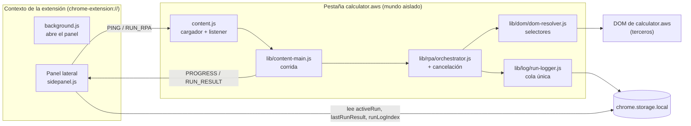

# Componentes lógicos — u1-walking-skeleton

> Inventario de los bloques lógicos del skeleton, sus dominios de fallo y su
> radio de impacto, como puente entre los requisitos no funcionales y el código.
> No hay infraestructura en la nube: todo corre en el navegador del SE. Prosa en
> español; identificadores en inglés.

## Sources

- `aidlc/spaces/default/intents/260922-calculator-rpa/construction/u1-walking-skeleton/functional-design/functional-spec.md` (estructura de módulos §2, contrato de mensajes §3, flujos W1-W4). [stage]
- `aidlc/spaces/default/intents/260922-calculator-rpa/construction/u1-walking-skeleton/nfr-requirements/tech-stack-decisions.md` (stack y ajustes al Diseño Funcional). [stage]
- `aidlc/spaces/default/intents/260922-calculator-rpa/construction/u1-walking-skeleton/nfr-requirements/security-requirements.md`, `reliability-requirements.md`, `observability-requirements.md`, `performance-requirements.md`, `scalability-requirements.md`. [stage]
- `aidlc/spaces/default/intents/260922-calculator-rpa/inception/contract-design/contract-summary.md` (interfaces internas; el cerebro no participa en el skeleton). [stage]
- `nfr-design-questions.md` de esta unidad: Q1 (escritura inmediata), Q2 (solo exportar). [Q1, Q2]

## Mapa de componentes

<!-- Text fallback: El panel lateral envía PING y RUN_RPA a content.js en la pestaña de calculator.aws. content.js carga content-main.js, que usa el orquestador, y este usa el resolvedor del DOM sobre la página de terceros. El orquestador registra todo por el run-logger, que es el único que escribe el registro en chrome.storage.local. content-main envía PROGRESS y RUN_RESULT al panel, y el panel lee activeRun, lastRunResult y runLogIndex del almacenamiento. background.js solo abre el panel. -->

## Inventario

| Componente | Archivo(s) | Responsabilidad NFR | Dominio de fallo | Zona |
|---|---|---|---|---|
| Panel lateral | `sidepanel.html`, `sidepanel.js` | Validar entrada, handshake, mostrar progreso/resultado, latido de 60 s, listar/exportar/borrar registros | Contexto de la extensión | B |
| Fondo | `background.js` | Abrir el panel al pulsar el icono | Contexto de la extensión | B |
| Cargador | `content.js` | Guardia de carga única, único listener, `PING {ok, ready}`, `import()` | Pestaña | B |
| Corrida | `lib/content-main.js` | Recibir `RUN_RPA`, guardián `busy`, `activeRun`, emitir `PROGRESS`/`RUN_RESULT`, marca de corrida cerrada | Pestaña | B |
| Orquestador | `lib/rpa/orchestrator.js` | Flujo por servicio, token de cancelación, agregación | Pestaña (lógica pura con el DOM inyectado) | A |
| Cronómetro y cancelación | `lib/rpa/service-timer.js` | Fecha límite de 180 s, disparo del token | Pura | A |
| Reintentos | `lib/rpa/retry.js` | Cotas de intentos/tiempo | Pura | A |
| Agregador | `lib/rpa/result-aggregator.js` | Veredicto todo-o-nada | Pura | A |
| Resolvedor del DOM | `lib/dom/dom-resolver.js` (+ `lib/dom/selectors.js`) | Única tabla de selectores; acciones; relectura; banner | DOM de terceros | B |
| Registro | `lib/log/run-logger.js`, `lib/log/log-index.js`, `lib/log/log-format.js` | Cola de un solo escritor, escritura inmediata por trozos, índice | Pestaña + almacenamiento | A (formato, índice, trozos) / B (I/O) |
| Entrada | `lib/input/json-parser.js`, `lib/input/input-normalizer.js` | Validación y normalización | Pura | A |
| Mapeo | `lib/mapping/deterministic-mapper.js`, `lib/mapping/region-map.js` | Coincidencia única | Pura | A |
| Conexión | `lib/connection/handshake.js` | Reutilizar/abrir, 1 + 3 `PING`, `ready` | Panel (API de Chrome inyectada) | A |
| Mensajes | `lib/messages.js`, `lib/validation.js` | Tipos de mensaje, validación de mensajes y URL | Pura | A |

## Dominios de fallo y radio de impacto

| Falla | Dónde se contiene | Qué ve el SE | Qué queda |
|---|---|---|---|
| Cambio de UI en calculator.aws | `dom-resolver` (una tabla de selectores) | Resultado tipado del servicio, sin URL | Registro con el selector que falló |
| Pestaña cerrada o recargada a mitad de corrida | El panel (latido 60 s / `tabs.onRemoved`) | ERROR `lost` | Registro completo hasta el último evento (escritura inmediata) |
| `import()` del módulo falla | `content.js` (`ok: false`) | "Recarga la pestaña de calculator.aws" | Mensaje en consola |
| Servicio lento | `service-timer` (corte de 180 s) | `service_timeout` | Registro + estimado posiblemente con el servicio |
| Panel cerrado | Nada se pierde: la corrida sigue en la pestaña | Al reabrir: corrida en curso o "Última corrida" | `activeRun`, `lastRunResult` |
| Escritura en almacenamiento falla | `run-logger` | Aviso en el panel ("no pude guardar el registro"); la corrida sigue | Lo ya escrito |

Ningún fallo en la pestaña bloquea el panel, y ningún fallo del panel detiene una corrida en curso: son dos contextos de ejecución separados que solo se hablan por mensajes y por `chrome.storage.local`.

## Recursos compartidos

- `chrome.storage.local`: único recurso compartido. Escritores: `run-logger` (en la pestaña) escribe `runLog:*`, `runLogIndex`, `activeRun` y `lastRunResult` de corridas que terminan normalmente; el panel escribe solo `lastRunResult` cuando cierra una corrida como `lost` y borra entradas a pedido del SE. Cada clave tiene un dueño por momento, lo que evita escrituras cruzadas sobre la misma clave.
