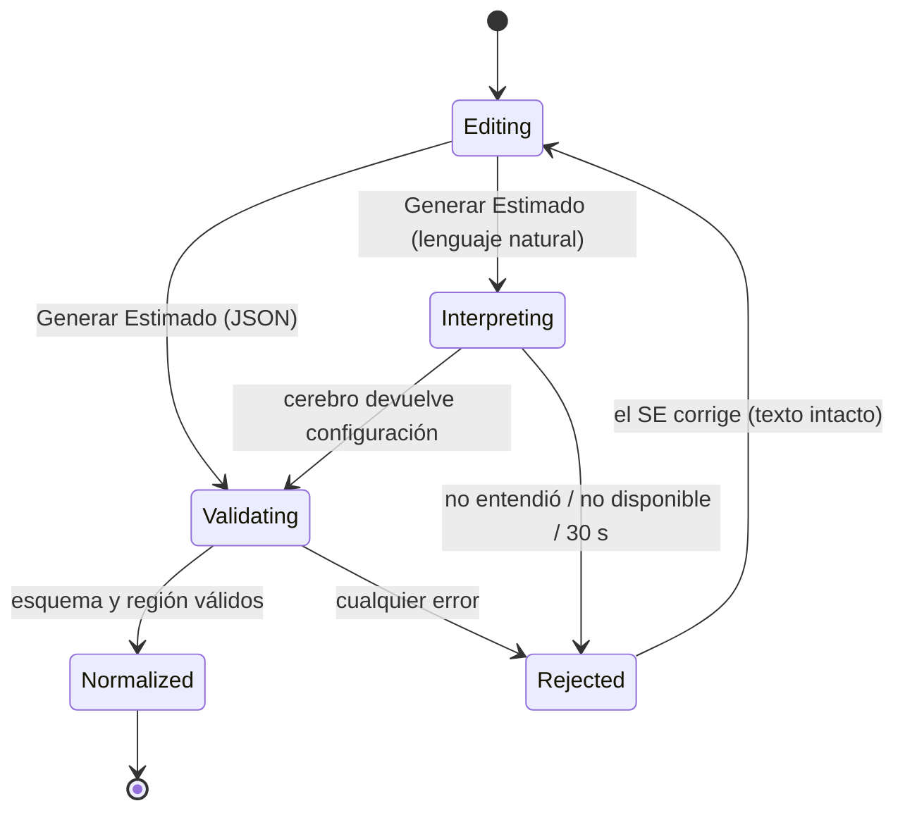
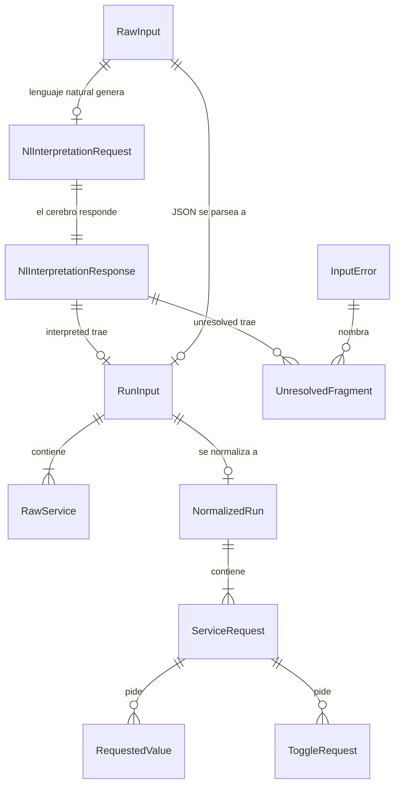

# Especificación funcional — u2-input-parsers

> Comportamiento de la entrada: del texto en la pestaña JSON o de lenguaje
> natural a la corrida normalizada que consumen el mapeo y el RPA. Este archivo
> es la fuente de verdad de los flujos y de los estados; el diagrama ER y el
> resumen de reglas se derivan de `entities.md` y `rules.md`. Implementa US2.1,
> US2.2 y US3.1 de `stories.md`. Prosa en español; identificadores en inglés.

## Sources

- `aidlc/spaces/default/intents/260922-calculator-rpa/inception/user-stories/stories.md` (US2.1, US2.2, US3.1). [stories]
- `aidlc/spaces/default/intents/260922-calculator-rpa/inception/units-generation/unit-of-work.md` (U2; reemplazo en sitio de los módulos provisionales de U1). [stage]
- `aidlc/spaces/default/intents/260922-calculator-rpa/inception/requirements-analysis/requirements.md` (FR1, FR8, NFR1, NFR3; Anexo A). [requirements]
- `aidlc/spaces/default/intents/260922-calculator-rpa/inception/domain-design/components.md` y `decisions.md` (ADR-005, ADR-006). [stage]
- `aidlc/spaces/default/intents/260922-calculator-rpa/inception/contract-design/contract-summary.md` (`normalize`). [stage]
- `aidlc/spaces/default/knowledge/calculator-catalog/README.md` (inventario de calculator.aws). [knowledge]
- `entities.md` y `rules.md` de esta unidad. [stage]
- `functional-design-questions.md` de esta unidad, Q1-Q4, Q1b, Q1c. [Q1-Q4]

## 1. Alcance

**Dentro:** validación estricta del JSON del Anexo A; envío del lenguaje natural al cerebro y validación de lo que devuelve; normalización común a `NormalizedRun`; errores tipados en español; marca de región por defecto y de revisión Well-Architected.

**Fuera (y quién lo tiene):**
- La interpretación del lenguaje natural y el inventario de servicios y campos que usa → U4 (cerebro), server-side. El bundle no lleva el inventario.
- La revisión Well-Architected antes de llenar y la evaluación al terminar → U4 (las ejecuta) y U6 (las muestra).
- Las pestañas, el aviso de región por defecto y el render de errores → U6.
- Mapear valores a campos del formulario → U3; ejecutar en el DOM → U5.

## 2. Decisiones que fijan el diseño

| Decisión | Origen | Efecto |
|---|---|---|
| La IA interpreta, el bot ejecuta | Q1 | No hay gramática local de lenguaje natural. El inventario muestra que el 78 % de los campos son cantidades, pero a qué campo va cada valor y qué subservicio o plantilla se quiere no se resuelven con un catálogo (README del inventario). |
| Una sola validación para JSON y para la respuesta del cerebro | Q1 + Q4 | El cerebro no puede colar claves inventadas: su salida se trata como un JSON pegado (BR3.3). |
| Esquema cerrado | Q4 | Un error de tipeo como `feilds` falla en vez de descartar campos en silencio (BR2.5). |
| Pestañas JSON / lenguaje natural | Q3 | Sin detección automática (BR1.1). Cambia FR1, que pedía entrada sin selector de modos. |
| us-east-1 por defecto, visible | Q2 | `regionDefaulted` informa al panel (BR4.1). El ejemplo de AC2.2.2 sobre la región ya no aplica: el resto de AC2.2.2 se cubre con los fragmentos no interpretados. |
| Revisión Well-Architected obligatoria, desde U4 | Q1b, Q1c | `wafReview` (BR5.4). Cambia FR8.1, que la hacía opcional y posterior. |

## 3. Módulos (reemplazo en sitio de U1)

| Módulo | Estado tras U2 | Responsabilidad |
|---|---|---|
| `lib/input/json-parser.js` | Completa el provisional de U1 | Grupo 2: sintaxis, raíz, `services`, tipos y esquema cerrado. Lo usan el camino JSON y la validación de la respuesta del cerebro. |
| `lib/input/nl-interpreter.js` | Nuevo | Grupo 3: arma `NlInterpretationRequest`, llama al puerto de interpretación inyectado y traduce la respuesta a `RunInput` o `InputError`. No contiene gramática. |
| `lib/input/input-normalizer.js` | Completa el provisional de U1 | Grupo 4 y `normalize(rawInput, deps)`, la interfaz pública. Pasa de `normalize(runInput)` síncrono a `normalize(rawInput, deps)` asíncrono, porque el camino de lenguaje natural espera al cerebro. El llamador de U1 (`sidepanel.js`) se ajusta en Code Generation. |
| `lib/input/input-errors.js` | Nuevo | Códigos de `InputError` y sus mensajes en español. |

**Puerto de interpretación.** `normalize` recibe en `deps` un `interpretNaturalLanguage(request, { signal }) → Promise<NlInterpretationResponse>`. La revisión es obligatoria si y solo si el puerto existe (BR5.4); no hay un indicador aparte. U2 no sabe dónde vive el cerebro: U4 y U7 conectan la implementación real. Hasta entonces el puerto es `null` y el camino de lenguaje natural responde `brain_unavailable` (BR3.5). Esto mantiene la capa de mapeo extraíble a su propio módulo (`project.md`).

**Interfaz pública:**

```
normalize({ format, text }, { interpretNaturalLanguage, signal })
  → Promise<{ ok: true, value: NormalizedRun } | { ok: false, error: InputError }>

interpretNaturalLanguage(NlInterpretationRequest, { signal }) → Promise<NlInterpretationResponse>
```

`signal` es el `AbortSignal` de la corrida, creado por U6. Si se aborta (el SE cancela o sale de la pestaña), U2 descarta la respuesta que llegue después y resuelve `{ ok: false, error: { code: "cancelled" } }`, que U6 no muestra como error. U2 no genera ni compara identificadores de petición. El `requestId` que guarda el panel (frontend-components de u6) es solo para el filtrado de U6 y no cruza esta interfaz.

## 4. Flujos

### W1 — Entrada JSON

1. El SE pulsa "Generar Estimado" con la pestaña JSON activa (BR1.1).
2. Texto vacío → `empty_input` (BR1.2). Fin.
3. Parsear. Si falla → `invalid_json`, "❌ JSON inválido." (BR2.1). Fin.
4. Validar raíz, `services`, tipos, claves y topes en orden (BR2.2-BR2.5, BR2.7). En el primer error → `InputError` que nombra servicio y clave. Fin.
5. Normalizar (W3).

### W2 — Entrada en lenguaje natural

1. El SE pulsa "Generar Estimado" con la pestaña de lenguaje natural activa (BR1.1).
2. Texto vacío → `empty_input` (BR1.2); más de 2000 caracteres → `input_too_long` (BR3.1). Fin.
3. Si no hay puerto de interpretación → `brain_unavailable` (BR3.5). Fin.
4. Llamar `interpretNaturalLanguage({ text, locale: "es", schemaVersion: 1 }, { signal })` (BR3.2), con un tope de espera de 30 s.
5. `signal` abortada antes de la respuesta → `cancelled` (BR3.6). Sin respuesta, error de red o tope cumplido → `brain_unavailable` (BR3.5). Fin.
6. `status = unresolved` → `nl_unresolved` con los fragmentos (BR3.4). Fin.
7. `status = interpreted` → validar `runInput` con W1 paso 4 (BR3.3). Si falla o la forma es inválida → `nl_invalid_response`. Fin.
8. Normalizar (W3).

### W3 — Normalización común

1. Región: la de la configuración o `us-east-1` con `regionDefaulted = true` (BR4.1); validar contra la tabla (BR4.2).
2. Por cada servicio, en orden (BR2.6): `requestId = svc-N`; `searchTerm` (BR4.5); separar toggles de campos (BR4.4); valores a texto (BR4.3).
3. `wafReview` = `required` si `interpretNaturalLanguage` no es `null`, si no `not_available` (BR5.4).
4. Devolver `NormalizedRun` completo, o `InputError` sin servicios ante cualquier fallo (BR5.3).

### W4 — Corrección tras un error

1. El panel muestra el `InputError`; el texto y la pestaña quedan intactos (BR5.1).
2. El SE corrige y vuelve a pulsar "Generar Estimado".
3. Se descarta todo lo anterior y se empieza desde W1 o W2 (BR5.2).

## 5. Estados de la entrada



Texto equivalente: desde **Editing**, "Generar Estimado" lleva a **Validating** (JSON) o a **Interpreting** (lenguaje natural). Si el cerebro responde con una configuración, se pasa a **Validating**; si no entiende, no está disponible o se cumple el tope de 30 s, se pasa a **Rejected**. **Validating** termina en **Normalized** si todo es válido o en **Rejected** ante cualquier error. Desde **Rejected** el SE vuelve a **Editing** con el texto intacto. **Normalized** entrega la corrida al resto del flujo.

## 6. Ejemplos

- **JSON canónico del skeleton** (EC2 t3.micro en us-east-1): pasa igual que en U1; `regionDefaulted = false`, `source = json`.
- **JSON con clave mal escrita**: `{"services":[{"name":"Amazon S3","feilds":{}}]}` → `unknown_key`: "❌ El servicio "Amazon S3" tiene una clave desconocida: "feilds"."
- **Lenguaje natural canónico** (AC2.1.1): "Un bucket S3 Standard de 100 GB en la región us-east-1" → el cerebro devuelve la configuración de S3 Standard con 100 GB; la normalización produce el mismo `NormalizedRun` que el JSON equivalente salvo `source` (BR4.6).
- **Lenguaje natural ambiguo** (AC2.2.2): "Un S3 de 100 GB" → el cerebro devuelve `unresolved` con "100 GB" y motivo `ambiguous_field` → "no sé a qué campo de S3 Standard corresponden "100 GB""; no se llena nada.

## 7. Cambios a requisitos que esta etapa registra

- **FR1**: la entrada tiene pestañas JSON / lenguaje natural (Q3), en lugar de "sin selector de modos".
- **FR1.1**: el lenguaje natural lo interpreta el cerebro con el inventario de la calculadora; el parser local no interpreta (Q1). Resuelve OQ4.
- **FR8.1**: la revisión Well-Architected es obligatoria para toda corrida, antes de llenar y al terminar, desde que U4 se integra (Q1b, Q1c).

- **AC2.2.2**: el ejemplo "no reconocí la región para el bucket S3" deja de aplicar porque la región faltante toma us-east-1 (Q2); el resto del criterio se cumple con los fragmentos no interpretados (BR3.4).
- **Anexo A**: cada servicio admite `template` (u5) y los toggles `__switch__:` viven dentro de `fields`.
- **ADR-006 y nota de U2 en `unit-of-work.md`**: el parseo local de lenguaje natural ya no existe; la interpretación siempre la hace el cerebro (Q1).
- **`contract-summary.md`**: C3 `/interpret` (u4) y la firma única `normalize({format, text}, {interpretNaturalLanguage, signal}) → Promise<{ok: true, value: NormalizedRun} | {ok: false, error: InputError}>`, la del puerto `interpretNaturalLanguage(request, {signal})` y los topes comunes de BR2.7 (iguales a los de C2); todo registrado.

Afectan a U4 (endpoint de interpretación con el inventario y revisión previa), a U6 (pestañas, avisos, texto plano) y a U7 (host del cerebro).

## 8. Diagrama entidad-relación (derivado de `entities.md`)



Texto equivalente: el lenguaje natural genera una solicitud al cerebro; su respuesta trae una configuración (`RunInput`) o fragmentos no interpretados. El JSON se parsea directo a `RunInput`. `RunInput` contiene servicios crudos y se normaliza a `NormalizedRun`, que contiene `ServiceRequest` con sus valores y toggles. Un `InputError` puede nombrar fragmentos no interpretados.

## 9. Resumen de reglas (derivado de `rules.md`)

| Grupo | Reglas | Qué garantizan |
|---|---|---|
| Camino | BR1.1-BR1.2 | La pestaña decide; texto vacío no hace nada |
| JSON | BR2.1-BR2.6 | Anexo A estricto, errores que nombran servicio y clave, orden respetado |
| Lenguaje natural | BR3.1-BR3.5 | El cerebro interpreta; su salida se valida como JSON; nada parcial; caída visible |
| Normalización | BR4.1-BR4.6 | Región por defecto visible, toggles, valores a texto, ambos formatos convergen |
| Recuperación y Well-Architected | BR5.1-BR5.4 | Texto intacto, cada corrida desde cero, un único resultado tipado, revisión obligatoria desde U4 |

## 10. Verificación

Todo U2 es Zona A: Vitest con el piso del 80 % de líneas. El puerto de interpretación se reemplaza por un doble que devuelve `interpreted`, `unresolved`, una forma inválida, un error o ninguna respuesta (con temporizadores falsos para los 30 s). Los casos mínimos son AC2.1.1, AC2.1.2, AC2.2.1, AC2.2.2, AC3.1.1, AC3.1.2, AC3.1.3 y AC3.1.4, más la convergencia JSON / lenguaje natural (BR4.6). AC2.2.3 se reparte: lo que garantiza U2 (BR5.1, BR5.2) se prueba aquí, y la edición del texto en el panel se prueba en U6.
