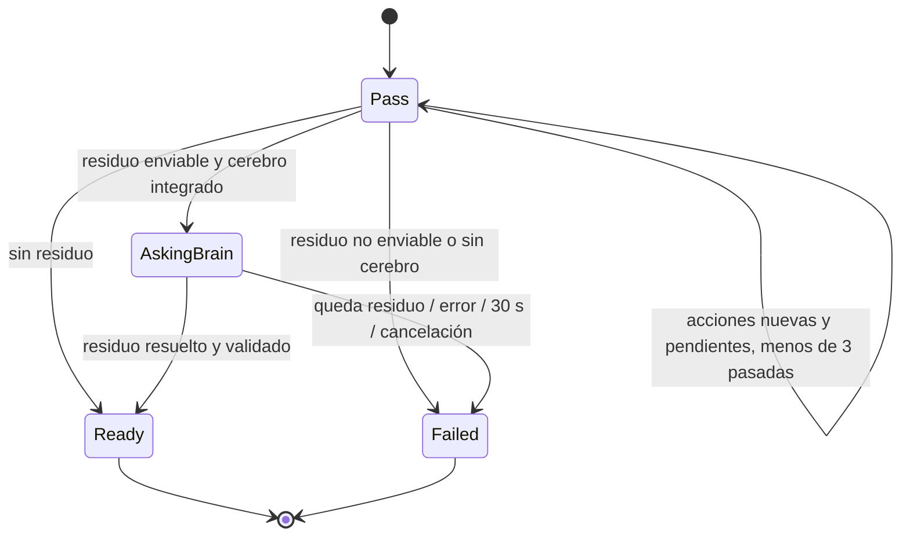
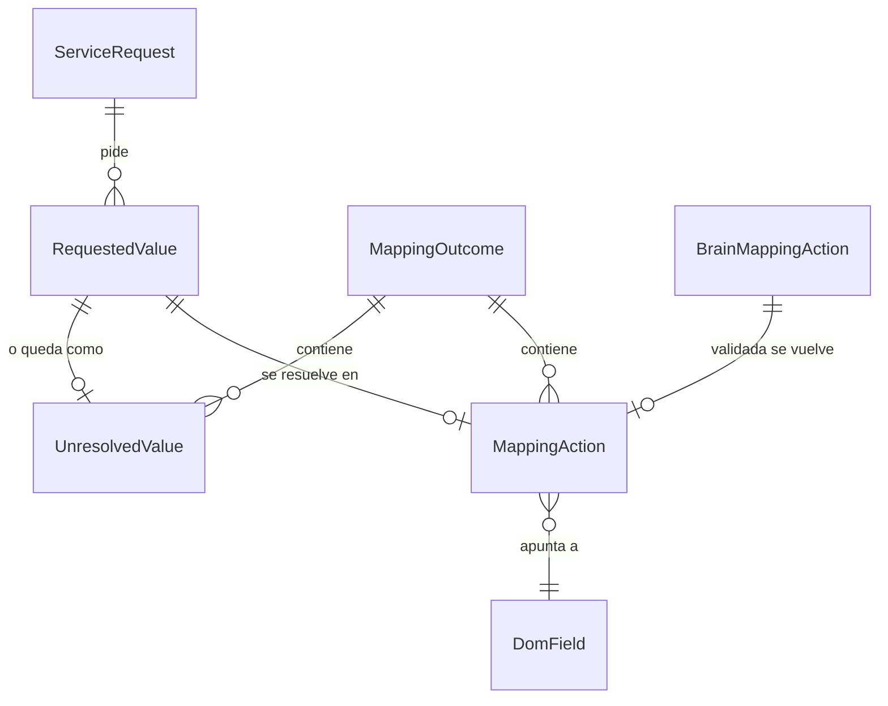

# Especificación funcional — u3-deterministic-mapper

> Comportamiento del mapeo campo ↔ valor de un servicio: de los campos
> escaneados y los valores pedidos a una lista ordenada de acciones, o a un
> fallo tipado que nombra lo que no se pudo mapear. Fuente de verdad de los
> flujos y estados; el diagrama ER y el resumen de reglas se derivan de
> `entities.md` y `rules.md`. Implementa la parte de mapeo de US4.1 de
> `stories.md` (la ejecución es de U5). Prosa en español; identificadores en
> inglés.

## Sources

- `aidlc/spaces/default/intents/260922-calculator-rpa/inception/user-stories/stories.md` (US4.1). [stories]
- `aidlc/spaces/default/intents/260922-calculator-rpa/inception/units-generation/unit-of-work.md` (U3; reemplazo en sitio de U1). [stage]
- `aidlc/spaces/default/intents/260922-calculator-rpa/inception/requirements-analysis/requirements.md` (FR3, FR5.2, NFR3, NFR7). [requirements]
- `aidlc/spaces/default/intents/260922-calculator-rpa/inception/domain-design/components.md` y `decisions.md` (ADR-001, ADR-002). [stage]
- `aidlc/spaces/default/intents/260922-calculator-rpa/inception/contract-design/contract-summary.md` (C1, `mapDeterministic`). [stage]
- `aidlc/spaces/default/knowledge/calculator-catalog/README.md`. [knowledge]
- `entities.md` y `rules.md` de esta unidad; `functional-design-questions.md`, Q1-Q3. [Q1-Q3]

## 1. Alcance

**Dentro:** coincidencia de etiquetas, tipo de acción, validación de números, opciones, checkboxes y toggles pedidos como campo, mapeo por pasadas para campos condicionales, consulta única del residuo al cerebro y validación de su respuesta, fallo tipado por residuo.

**Fuera:** aplicar los `__switch__` antes del escaneo, escanear el formulario y ejecutar las acciones (U5); interpretar lenguaje natural (U2 + U4); la lógica del cerebro detrás de `/map-residue` (U4).

## 2. Decisiones

| Decisión | Origen | Efecto |
|---|---|---|
| Unidad con clave propia | Q1 = B | "100 GB" en un campo numérico es inválido (BR2.2); la unidad va en "<Campo> unit" (BR2.3). Exige a U5 escanear el selector de unidad como su propio campo y a U4 producir ambas claves (§7). |
| Una consulta al cerebro y falla | Q2 = A | El residuo enviable se consulta una vez, tras las pasadas; lo que siga sin resolverse hace fallar el servicio (BR3.2-BR3.4). |
| Clave con sección | Q3 = A | Etiqueta repetida sin sección → `ambiguous_label`, que no va al cerebro y hace fallar el servicio (BR1.3). |
| Pasadas para campos condicionales | Inventario (31 % condicionales) | Un campo que aparece al elegir otro se mapea en una pasada posterior; `no_match` solo es definitivo al terminar las pasadas (BR3.1). |
| Toggles en U5 | AC4.1.3, U1 `prepareForm` | Los `__switch__` se aplican antes del primer escaneo; U3 no los ordena ni los emite (BR2.6). |

## 3. Módulos (reemplazo en sitio de U1)

| Módulo | Estado tras U3 | Contenido |
|---|---|---|
| `lib/mapping/deterministic-mapper.js` | Completa el provisional | `mapDeterministic(domFields, requestedValues, previousOutcome?) → MappingOutcome` (Grupos 1-2 y una pasada de BR3.1). Los dos primeros parámetros no cambian respecto a U1; el tercero es opcional y acumula las pasadas. |
| `lib/mapping/option-match.js` | Completa el provisional | Normalización, coincidencia de opciones y patrón numérico (BR1.1, BR2.2, BR2.4, BR2.5); también la usa U5 al ejecutar. |
| `lib/mapping/residue-resolver.js` | Nuevo | `resolveResidue(outcome, { serviceName, domFields, requestedValues }, { mapResidue, signal }) → Promise<MappingOutcome>` (BR3.2-BR3.4). Sin puerto, devuelve `brain_unavailable` sin esperar. |

## 4. Flujos

### M1 — Una pasada de mapeo (determinística)

Entrada: el escaneo actual y los valores pendientes (en la primera pasada, todos los `fields` del servicio).

1. Por cada valor pendiente, en el orden de la configuración: buscar coincidencia única (BR1.1-BR1.3) y comprobar que el campo no esté usado (BR1.4).
2. Derivar el tipo de acción (BR2.1) y validar el valor según el tipo (BR2.2, BR2.4, BR2.5).
3. Si todo pasa → acción `source = deterministic`. Si el motivo es `no_match` → el valor queda pendiente. Cualquier otro motivo → residuo definitivo.
4. Devolver el `MappingOutcome` acumulado con `newActionsInLastPass`.

### M2 — Ciclo de pasadas (lo ejecuta U5, con reglas de U3)

1. U5 aplica los toggles del servicio y hace el primer escaneo.
2. M1 sobre ese escaneo. U5 aplica las acciones nuevas.
3. Si hubo acciones nuevas, quedan pendientes y van menos de 3 pasadas → U5 vuelve a escanear y repite M1 con los pendientes.
4. Si no → los pendientes pasan al residuo con `no_match` (BR3.1).

### M3 — Residuo

1. Sin residuo → `residueStatus = none`; el servicio sigue al guardado.
2. Residuo con algún motivo no enviable, o sin puerto → fallo (BR3.4).
3. Llamar una vez a `/map-residue` con el último escaneo y el residuo enviable; tope de 30 s y señal de la corrida (BR3.2). Error, tope o cancelación → `brain_unavailable` y fallo.
4. Validar la forma de la respuesta y cada acción (BR3.3); aceptar las válidas con `source = brain` y agregarlas al final.
5. U5 aplica las acciones aceptadas. Residuo vacío → `resolved_by_brain`; si queda algo → `still_unresolved` y fallo sin guardar (BR3.4).

### Motivo que ve el SE

Un servicio que falla por mapeo produce `ServiceResult.reason = field_not_recognized` (motivo existente de U1) con un detalle "clave: motivo" por cada valor. U5 traduce cada motivo en el mensaje en español: `no_match` "no encontré el campo", `ambiguous_label` "el campo aparece en más de una sección; indica 'Sección > Campo'", `invalid_number` "debe ser un número sin unidad", `option_no_match` "no es una opción del campo", `duplicate_target` "dos claves apuntan al mismo campo", `unsupported_type` "ese tipo de campo no se puede llenar", `invalid_value` "valor no válido para ese campo", y `brain_unavailable` "no pude consultar el servicio de mapeo".

## 5. Estados del mapeo de un servicio

Texto equivalente: cada **Pass** mapea lo pendiente contra el escaneo actual. Si produjo acciones nuevas y quedan valores pendientes, se hace otra pasada (máximo 3). Al terminar: sin residuo → **Ready**. Con residuo enviable y cerebro → **AskingBrain**. Con residuo no enviable o sin cerebro → **Failed**. **AskingBrain** pasa a **Ready** si todo el residuo se resolvió con acciones válidas; si no, o ante error, tope o cancelación, pasa a **Failed**. **Ready** sigue al guardado; **Failed** produce el resultado del servicio con motivo y el servicio no se guarda.

## 6. Ejemplos

- **EC2 canónico (U1):** "Operating system" = "Linux", "Instance type" = "t3.micro" → dos acciones en la primera pasada; sin residuo.
- **Almacenamiento con unidad:** "Storage amount" = "30", "Storage amount unit" = "GB" → `fill 30` y `dropdown GB`. Con "Storage amount" = "30 GB" → `invalid_number`, fallo.
- **Campo condicional:** "Provisioning IOPS io2" solo aparece si "Storage for each EC2 instance" = io2. Pasada 1 elige io2 y deja IOPS pendiente; pasada 2 lo encuentra y lo mapea.
- **Etiqueta repetida en EC2:** "Storage for each EC2 instance" sin sección → `ambiguous_label` y fallo, sin consultar al cerebro.
- **Diferencia con la página viva:** la configuración dice "Number of requests" pero el formulario dice "Requests" → `no_match` tras las pasadas → `/map-residue` devuelve `{ requestKey: "Number of requests", fieldLabel: "… > Requests", actionType: "fill", value: "1000000" }`; el valor es igual al pedido → aceptada → `resolved_by_brain`. Si devolviera `value: "100000"`, se descarta y el servicio falla.

## 7. Impacto en otras unidades y en los contratos

Cambios que esta unidad pide registrar en `contract-summary.md` antes de que U4 y U5 diseñen:

- **C1 `/map-residue`:** cada acción de la respuesta lleva `requestKey` (agregado al esquema `MappingAction` de la respuesta; cambio aditivo, dueño U4). Sin él la respuesta no se puede asociar al residuo y todas sus acciones se descartan.
- **DomField de unidad:** U5 escanea el selector de unidad o periodo de un campo con unidad como un DomField propio de tipo `dropdown` o `select` con etiqueta "<Sección> > <Campo> unit". Sin esto, los 1 226 campos valor + unidad del inventario quedan con la unidad por defecto o en `no_match`.
- **U4 (interpretación de lenguaje natural):** produce la unidad como clave aparte; en `/map-residue` solo devuelve etiquetas de los campos recibidos y el valor pedido sin transformarlo (salvo elegir la opción equivalente en selectores).

Cambios en el código de U1 que hace Code Generation de U3:

- `orchestrator.js`: reemplazar el escaneo y mapeo únicos por el ciclo M2 y la llamada a `resolveResidue`, pasando la señal de la corrida; armar el detalle "clave: motivo".
- Los tests de U1 de `deterministic-mapper` y `orchestrator` se actualizan a la nueva salida (`UnresolvedValue` con motivo, pasadas).

## 8. Diagrama entidad-relación (derivado de `entities.md`)

Texto equivalente: un `ServiceRequest` pide valores. El mapeo produce un `MappingOutcome` con acciones y valores sin resolver. Cada acción apunta a un `DomField`. Una acción del cerebro solo se vuelve `MappingAction` si pasa la validación. Cada valor pedido termina como una acción o como un valor sin resolver.

## 9. Resumen de reglas (derivado de `rules.md`)

| Grupo | Reglas | Qué garantizan |
|---|---|---|
| Etiquetas | BR1.1-BR1.4 | Coincidencia exacta y única; sección obligatoria si se repite; un valor por campo |
| Acciones y valores | BR2.1-BR2.6 | Tipo de acción en paridad con C1; número simple sin unidad; unidad con clave propia; opción exacta; toggles en U5 |
| Pasadas y residuo | BR3.1-BR3.4 | Campos condicionales por pasadas; una consulta al cerebro solo por residuo enviable; respuesta validada contra el valor pedido; residuo final = fallo sin guardar |
| Módulo | BR4.1 | Función pura + puerto inyectado con señal |

## 10. Verificación

Zona A completa (Vitest, piso de 80 %): `mapDeterministic` con fixtures de DomField basados en el inventario (EC2 con campo condicional de IOPS, S3 Standard con unidades, un servicio con etiquetas repetidas) y una secuencia de escaneos que simula las pasadas. `resolveResidue` con un doble del puerto que devuelve acciones válidas, acciones sin `requestKey`, con valor distinto del pedido en un fill (descartada), una opción de `instance_radio` distinta de la pedida (aceptada con `substituted = true` y aviso), un selector sin `options` (descartada, queda `option_no_match`), con etiqueta inexistente, tipo equivocado o campo ya usado, una respuesta mal formada, un error, ninguna respuesta (temporizadores falsos) y una señal cancelada. La aplicación real sobre calculator.aws la cubre el smoke de U5.
