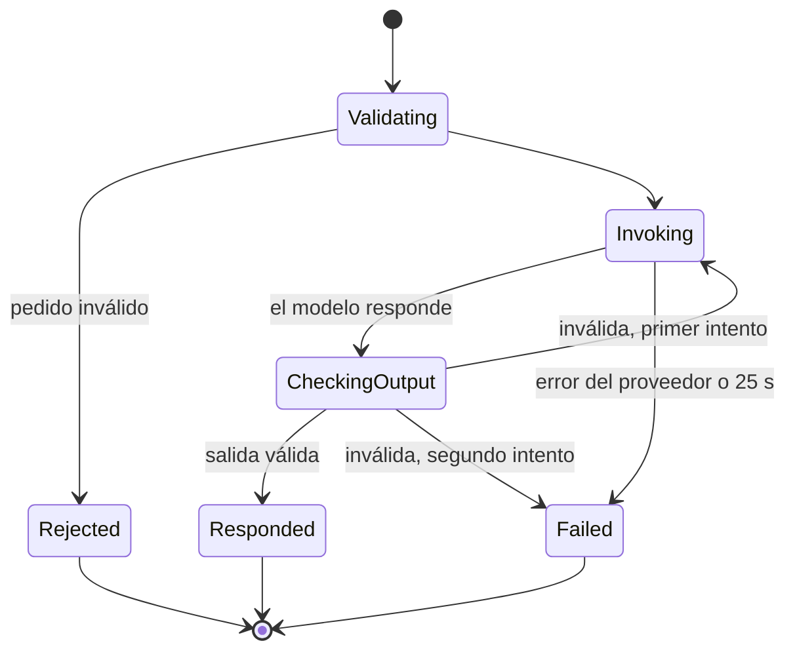
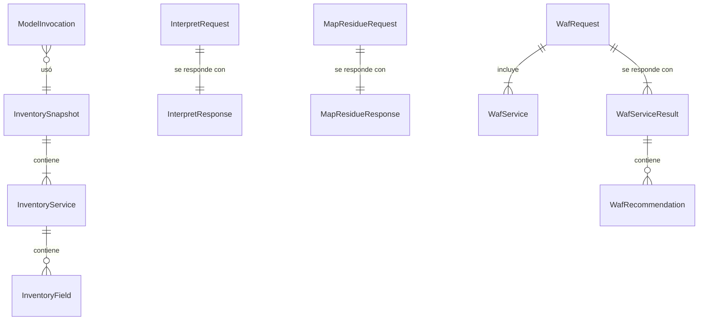

# Especificación funcional — u4-mapping-brain

> Comportamiento del cerebro server-side: interpretar lenguaje natural contra el
> inventario de calculator.aws, resolver el residuo de mapeo y evaluar con
> criterio Well-Architected antes y después de llenar. Fuente de verdad de los
> flujos y estados; el diagrama ER y el resumen de reglas se derivan de
> `entities.md` y `rules.md`. Implementa US5.1 de `stories.md` junto con U6, y
> los contratos que u2 y u3 necesitan. Prosa en español; identificadores en
> inglés.

## Sources

- `aidlc/spaces/default/intents/260922-calculator-rpa/inception/user-stories/stories.md` (US5.1). [stories]
- `aidlc/spaces/default/intents/260922-calculator-rpa/inception/units-generation/unit-of-work.md` (U4). [stage]
- `aidlc/spaces/default/intents/260922-calculator-rpa/inception/requirements-analysis/requirements.md` (FR8, NFR1, NFR3, NFR5). [requirements]
- `aidlc/spaces/default/intents/260922-calculator-rpa/inception/domain-design/components.md` y `decisions.md`. [stage]
- `aidlc/spaces/default/intents/260922-calculator-rpa/inception/contract-design/contract-summary.md`. [stage]
- `aidlc/spaces/default/knowledge/calculator-catalog/README.md`. [knowledge]
- `entities.md`, `rules.md` y `functional-design-questions.md` (Q1-Q4) de esta unidad. [Q1-Q4]

## 1. Alcance

**Dentro:** tres operaciones HTTP (interpretar, residuo, Well-Architected), validación de entrada y de la salida del modelo, inventario versionado, registro de invocaciones.

**Fuera:** el alojamiento, la autenticación extensión ↔ cerebro y la URL base (Infrastructure Design / NFR Design); la presentación de resultados (U6); el agente conversacional con memoria, que será una unidad propia sobre el mismo backend (Q2).

## 2. Decisiones

| Decisión | Origen | Efecto |
|---|---|---|
| Aviso con confirmación | Q1 | La revisión previa solo informa hallazgos con severidad; el SE elige en el panel (BR4.3). |
| Agente aparte | Q2 | El agente con memoria no se diseña aquí; se agrega como unidad nueva. |
| Inventario versionado | Q3 | El cerebro usa una copia semanal del inventario y la informa en cada respuesta (Grupo 5, BR1.6). |
| Claude en Bedrock | Q4 | Credencial por identidad IAM del servidor (BR1.3); el modelo exacto se fija en NFR Requirements. |

## 3. Operaciones

| Operación | Ruta | Contrato | Estado |
|---|---|---|---|
| Interpretar lenguaje natural | `POST /interpret` | C3 (nuevo): `InterpretRequest` → `InterpretResponse` | Lo pide u2 |
| Resolver residuo | `POST /map-residue` | C1 + `requestKey` en cada acción y `inventoryVersion` | Agregado pedido por u3 |
| Well-Architected | `POST /waf-evaluate` | C2 + `phase` en el pedido y `severity` en cada recomendación | Agregados pedidos por u2 y esta unidad |

Los tres son cambios aditivos según las reglas de ownership de C1/C2, salvo `requestKey`, que pasa a ser requerido en la respuesta de C1 (la extensión descarta acciones sin él). Se registran en §7 para actualizar `contract-summary.md`.

## 4. Flujos

### B1 — Interpretar

1. Validar el pedido (BR1.1, BR1.2).
2. Cargar el inventario activo (sin ninguna versión cargada → 503 `inventory_unavailable`, BR7.3). Elegir por código hasta 8 servicios candidatos (BR7.1); sin candidatos → `unresolved` con `unknown_service` sin invocar el modelo. Pasar al modelo la expresión, la lista compacta de nombres canónicos y los campos y opciones completos solo de los candidatos.
3. Validar la salida (BR2.1-BR2.3). Si no cumple, segundo intento indicando el problema (BR1.4).
4. Responder `interpreted` con `runInput`, o `unresolved` con fragmentos; siempre con `inventoryVersion`.
5. Registrar la invocación (BR6.1).

### B2 — Residuo

1. Validar el pedido.
2. Pasar al modelo los campos recibidos, los valores pedidos y el residuo.
3. Validar la salida (BR3.1); omitir claves sin campo (BR3.2); segundo intento si la forma es inválida.
4. Responder las acciones con `inventoryVersion`; registrar.

### B3 — Well-Architected

1. Validar el pedido.
2. Repartir los servicios en lotes de hasta 5 y evaluarlos en paralelo, cada lote con la configuración de sus servicios y el momento (`pre_fill` o `post_fill`), dentro de los 25 s (BR1.5).
3. Validar cada lote: cada servicio una vez con su `serviceIndex`, con hallazgos o "sin hallazgos", y el formato de cada recomendación (BR4.2); segundo intento del lote si falla.
4. Si todos los lotes son válidos, unirlos en orden en `WafResponse` con `inventoryVersion`; si alguno falla, la respuesta entera es el error de ese lote. Registrar.

### B4 — Inventario

1. Semanalmente, generar el inventario con el script del proyecto (BR5.1).
2. Comparar contra la versión activa (BR5.2): si pierde más del 10 %, `rejected` y aviso; si no, activar.
3. El chequeo de salud avisa si la versión activa tiene más de 14 días (BR5.3).

## 5. Estados de una operación

Texto equivalente: el pedido se valida (**Validating**); si es inválido termina en **Rejected** (`bad_request`). Si no, se invoca el modelo (**Invoking**). Con respuesta, se revisa la salida (**CheckingOutput**): válida → **Responded**; inválida en el primer intento → nuevo **Invoking**; inválida en el segundo → **Failed** (`empty_result`). Un error del proveedor o el tope de 25 s lleva a **Failed** (`model_unavailable` o `timeout`).

## 6. Ejemplos

- **Interpretar canónico:** "Un bucket S3 Standard de 100 GB en la región us-east-1" → `interpreted` con `services: [{ name: "S3 Standard", fields: { "S3 Standard storage": "100", "S3 Standard storage unit": "GB" } }]`, `region: "us-east-1"`.
- **Ambiguo:** "Un S3 de 100 GB" → "S3" es un paraguas con subservicios → `unresolved` con `{ fragment: "S3", reason: "ambiguous_service" }`.
- **Revisión previa:** un EC2 sin almacenamiento cifrado → `pre_fill` con una recomendación `Security`, `severity: high`; el SE decide.
- **Salida inválida dos veces:** el modelo devuelve un servicio sin pilar → `empty_result`; el panel muestra el error (AC5.1.2).

## 7. Impacto en otras unidades y contratos

- **`contract-summary.md`:** agregar C3 `/interpret`; en C2, `phase`, `severity`, `serviceIndex`, el envoltorio con `inventoryVersion` y los topes (20 servicios, 30 claves, 5 recomendaciones de 300 caracteres), que resuelven la pregunta abierta de tamaño de C2; `inventoryVersion` en las tres respuestas; tabla de códigos de error → HTTP (BR7.2).
- **C1, cambio de ruptura:** `requestKey` (igual a `RequestedValue.key` del residuo; con claves repetidas, la primera) pasa a ser requerido en cada acción y la extensión descarta acciones sin él. Requiere subir `info.version` de C1 a 2.0.0 y el acuerdo explícito del mantenedor, según las reglas de ownership; se pide en la compuerta de esta etapa.
- **u2:** agregar `region_unavailable` al enum de `UnresolvedFragment.reason`; los toggles llegan como claves `__switch__:` y los checkboxes como `true`/`false` (ya los acepta el esquema del Anexo A).
- **Plantillas:** el servicio lleva el campo `template` (u5) en vez de prefijar la plantilla en las claves.
- **Inventario:** el script emite la lista de regiones por servicio (no solo su cantidad), para poder comprobar `region_unavailable`. La lista de servicios canónicos para nombres repetidos (p. ej. cuál de las dos entradas "Amazon EC2") y los sinónimos en español viven en archivos versionados junto al script del inventario.
- **NFR Design (requisito registrado aquí):** autenticación extensión ↔ cerebro por encabezado y límite de tasa o tope de consumo por día, con dueño el mantenedor; BR6.2 solo mide, no limita.
- **U6:** mostrar los hallazgos `pre_fill` con severidad y las opciones "llenar igual" / "corregir"; agrupar las recomendaciones (AC5.1.3); mostrar texto del cerebro solo como texto plano.
- **U7:** declarar el host del cerebro en `host_permissions` cuando se fije el alojamiento.
- **Unidad nueva (agente con memoria):** reutiliza el mismo backend; se agrega al plan de unidades.

## 8. Diagrama entidad-relación (derivado de `entities.md`)

Texto equivalente: una versión del inventario contiene servicios y estos sus campos. Cada pedido de interpretación y de residuo tiene su respuesta. Un pedido Well-Architected incluye servicios y se responde con un resultado por servicio, que contiene recomendaciones. Cada invocación del modelo registra la versión de inventario que usó.

## 9. Resumen de reglas (derivado de `rules.md`)

| Grupo | Reglas | Qué garantizan |
|---|---|---|
| Comunes | BR1.1-BR1.6 | Entrada acotada, sin imágenes, credencial server-side, salida validada, ≤ 25 s, versión informada |
| Interpretar | BR2.1-BR2.3 | Solo inventario; nada parcial; nada inventado |
| Residuo | BR3.1-BR3.2 | Acciones solo sobre campos recibidos y con el valor pedido |
| Well-Architected | BR4.1-BR4.3 | Dos momentos; cada servicio presente; el SE decide |
| Inventario | BR5.1-BR5.3 | Semanal, protegido contra regresiones, aviso de antigüedad |
| Registro | BR6.1-BR6.2 | Costo medido por operación sin datos del cliente |

## 10. Verificación

La validación de pedidos y de salidas (BR1.1, BR1.4, BR2.1-BR2.3, BR3.1, BR4.2, BR5.2) es lógica pura y se prueba con un doble del modelo que devuelve salidas válidas, inválidas y errores. La calidad de las interpretaciones y recomendaciones se mide con un conjunto de expresiones de referencia (al menos el caso canónico de cada servicio del alcance) en Build and Test.
