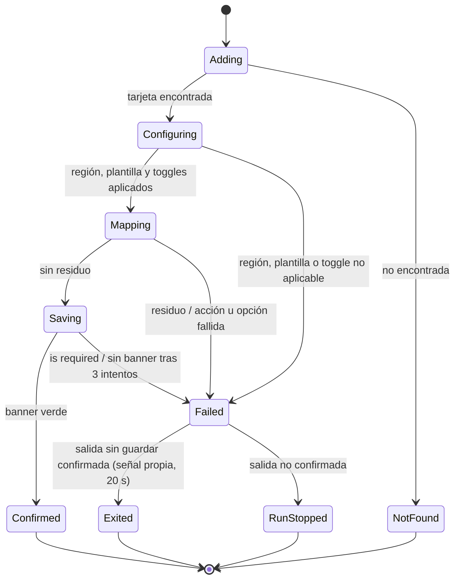
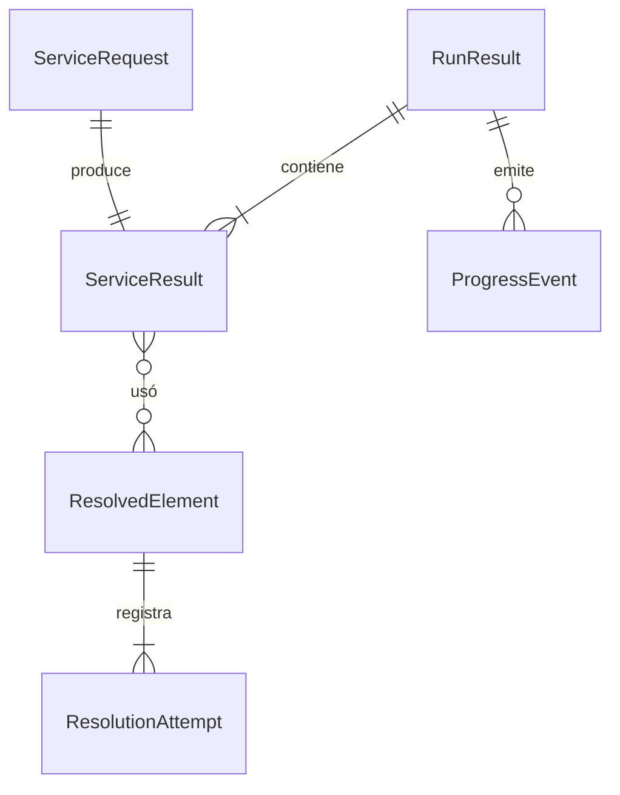

# Especificación funcional — u5-rpa-dom

> Comportamiento del RPA sobre calculator.aws para una corrida de varios
> servicios. Fuente de verdad de los flujos y estados; el diagrama ER y el
> resumen de reglas se derivan de `entities.md` y `rules.md`. Implementa US4.1
> (ejecución), US4.2, US4.3, US4.4, US6.1 y US6.2 (resultado y progreso), US7.1
> y US8.1 de `stories.md`. Prosa en español; identificadores en inglés.

## Sources

- `aidlc/spaces/default/intents/260922-calculator-rpa/inception/user-stories/stories.md`. [stories]
- `aidlc/spaces/default/intents/260922-calculator-rpa/inception/units-generation/unit-of-work.md` (U5; reemplazo en sitio de U1). [stage]
- `aidlc/spaces/default/intents/260922-calculator-rpa/inception/requirements-analysis/requirements.md`. [requirements]
- `aidlc/spaces/default/intents/260922-calculator-rpa/inception/domain-design/components.md`. [stage]
- `aidlc/spaces/default/intents/260922-calculator-rpa/inception/contract-design/contract-summary.md`. [stage]
- `aidlc/spaces/default/knowledge/calculator-catalog/README.md`. [knowledge]
- `entities.md`, `rules.md` y `functional-design-questions.md` (Q1-Q4) de esta unidad. [Q1-Q4]

## 1. Alcance

**Dentro:** corrida multi-servicio, plantilla, toggles, pasadas de mapeo, residuo, cascada de resolución, FIX-1 a FIX-9, guardado, salida sin guardar, agregación todo-o-nada, verificación del estimado, renombrado, Share, progreso, spotlight.

**Fuera:** handshake y panel (U1/U6), mapeo (U3), cerebro (U4), entrada (U2).

## 2. Decisiones

| Decisión | Origen | Efecto |
|---|---|---|
| Seguir y no dar URL | Q1 | Todos los servicios se procesan; los faltantes se listan (BR1.1, BR1.2). |
| Plantilla elegible | Q2 | `ServiceRequest.template` abre un modo concreto (BR2.1). Cambia u2, u3 y u4 (§7). |
| Salir sin guardar | Q3 | Un servicio fallido no deja el formulario abierto; el panel dice en qué campo se detuvo (BR2.5). |
| Spotlight incluido | Q4 | BR5.1, BR5.2. |

## 3. Módulos (reemplazo en sitio de U1)

| Módulo | Zona | Contenido |
|---|---|---|
| `lib/rpa/orchestrator.js` | A | Flujos R1/R2 sobre un resolvedor inyectado. |
| `lib/rpa/result-aggregator.js` | A | `aggregate` y `finalizeRunResult` (BR1.2). |
| `lib/rpa/retry.js` | A | `RetryCounter` puro (BR4.1). |
| `lib/dom/aria-label.js` | A | `cleanAriaLabel`, `parseUnitButtonLabel` (BR3.2, BR3.3). Hoy viven en `dom-utils.js` fuera de la cobertura: pasan a un módulo puro dentro de ella. |
| `lib/dom/cascade.js` | A | `selectByCascade` y el cálculo de `aria-labelledby` reconstruido sobre textos ya extraídos (BR3.1). |
| `lib/dom/dom-resolver.js`, `form-scanner.js`, `dom-utils.js` | B | Juntar candidatos por estrategia, FIX, plantilla, opciones al abrir (BR2.8), salida sin guardar. |
| `lib/dom/selectors.js` | B | Único punto de selectores frágiles (BR3.5). |
| `lib/dom/spotlight.js` | B | Overlay (BR5.1, BR5.2). |

## 4. Flujos

### R1 — Corrida

1. Verificar estimado vacío (U1 BR5.5).
2. Por cada servicio en orden (BR1.1): ejecutar R2 dentro de su corte de 3 minutos (BR2.7); emitir progreso (BR4.2).
3. Si algún servicio falló → `ERROR`, `missing` con sus nombres, sin URL (BR1.2).
4. Si todos se confirmaron → verificar que My Estimate contiene exactamente lo pedido, renombrar si hay `project`, Share y aceptar el modal público; devolver la URL (BR1.2).

### R2 — Servicio

1. Add service → buscar `searchTerm` → elegir la tarjeta con coincidencia exacta → Configure (si no aparece: `service_not_found`).
2. Si es el primer servicio, fijar la región (BR1.3).
3. Si hay `template`, seleccionarla (BR2.1).
4. Aplicar toggles (BR2.2).
5. Pasadas de mapeo y residuo (BR2.3), con spotlight, opciones exactas al abrir (BR2.8) y relectura en cada acción (BR5.1, BR2.4).
6. Guardar y confirmar por banner verde (BR2.6).
7. Ante un fallo en 2-6 (formulario abierto): salir sin guardar con señal propia y 20 s, registrar `stoppedAtLabel` y el motivo (BR2.5), y seguir con el siguiente servicio. Si la salida no se confirma, la corrida se detiene y los restantes quedan `not_attempted`. Un fallo en 1 (`service_not_found`) no abre formulario y sigue directo.

## 5. Estados de un servicio

Texto equivalente: el servicio se agrega (**Adding**); si la tarjeta no aparece, termina en **NotFound** sin formulario abierto. Al configurarse (**Configuring**) se aplican región (solo el primero), plantilla y toggles; si alguno no se puede aplicar, falla. En **Mapping** se llenan los campos por pasadas; residuo, acción u opción fallida → falla. En **Saving** el banner verde lo confirma; `is required` o tres intentos sin banner → falla. Un servicio fallido con formulario abierto sale sin guardar (**Exited**); si esa salida no se confirma en 20 s, la corrida se detiene (**RunStopped**). El corte de 3 minutos lleva a **Failed** desde Configuring, Mapping o Saving.

## 6. Ejemplos

- **Tres servicios, el segundo falla por `is required`:** el primero y el tercero se confirman; el segundo sale sin guardar con `validation_required` y el campo donde se detuvo; resultado `ERROR`, `missing: ["Amazon RDS for MySQL"]`, sin URL.
- **EC2 Advanced:** `template: "Advanced estimate"` → se abre ese modo antes de escanear; si la calculadora no lo ofrece, `template_not_found`.
- **Sustitución del cerebro:** se pidió "Instance type: t3.m" y el cerebro eligió la opción escaneada "t3.medium" (`substituted = true`) → el servicio se confirma y el mensaje avisa "Pediste t3.m; se usó t3.medium". Si el cerebro elige exactamente la opción pedida, no hay aviso.

## 7. Impacto en otras unidades

Cambios de contrato ya aplicados en `contract-summary.md` (sección "Cambios de Functional Design (2026-11-21)"), `requirements.md` y `components.md` (la entidad `ServiceRequest` es de u2):

- **u2 / Anexo A / `requirements.md`:** cada servicio admite la clave `template` (texto no vacío) a nivel de servicio, junto a `name`, `search_term` y `fields`; `ServiceRequest.template`. No se usa `__template__` dentro de `fields` (U1 lo trataría como un campo); el esquema cerrado de u2 (BR2.5) debe agregar `template` a las claves admitidas.
- **`contract-summary.md`:** `aggregate(requested, serviceResults) → RunResult (DONE | ERROR)`; se quita `PARTIAL` (todo-o-nada) y se registra la firma que ya usa U1.
- **u3:** las claves son etiquetas del formulario de la plantilla abierta; la sección es la del formulario, no la plantilla.
- **u4:** el cerebro devuelve `template` en el servicio cuando la expresión pide un modo concreto, en vez de prefijar la plantilla en las claves (reemplaza esa parte de su BR2.1); el inventario ya registra la plantilla de cada campo.
- **u6:** mostrar la lista por servicio, faltantes, `stoppedAtLabel` y cada sustitución del cerebro como "pediste X, se usó Y".

## 8. Diagrama entidad-relación (derivado de `entities.md`)

Texto equivalente: un `RunResult` contiene un `ServiceResult` por cada `ServiceRequest`. Cada elemento resuelto registra los intentos de la cascada. La corrida emite eventos de progreso.

## 9. Resumen de reglas (derivado de `rules.md`)

| Grupo | Reglas | Qué garantizan |
|---|---|---|
| Corrida | BR1.1-BR1.3 | Todos los servicios se procesan; URL solo con todo confirmado |
| Servicio | BR2.1-BR2.7 | Plantilla, toggles, pasadas, relectura, salida sin guardar, banner verde, 3 min |
| Resolución | BR3.1-BR3.5 | Cascada, FIX del v6, selectores centralizados |
| Resultado | BR4.1-BR4.3 | Reintentos puros, progreso, resultado por servicio |
| Spotlight | BR5.1-BR5.2 | Visible, sin interferir, siempre limpio |

BR2.8 (opciones al abrir: coincidencia exacta y única) pertenece al grupo Servicio.

## 10. Verificación

Zona A (Vitest, piso 80 %): `selectByCascade` en `lib/dom/cascade.js` (cada estrategia con 0, 1 y varios candidatos, con y sin sección, y el cálculo de `aria-labelledby` reconstruido); orquestador con resolvedor falso (multi-servicio con fallos intermedios, plantilla inexistente, corte de 3 min), agregador, contador de reintentos, `cleanAriaLabel` y `parseUnitButtonLabel` con sus tablas de casos. Zona B (smoke de `SMOKE.md`): cascada, FIX-3/5/6/8/9, plantilla de EC2 Advanced, salida sin guardar y spotlight en calculator.aws real.
