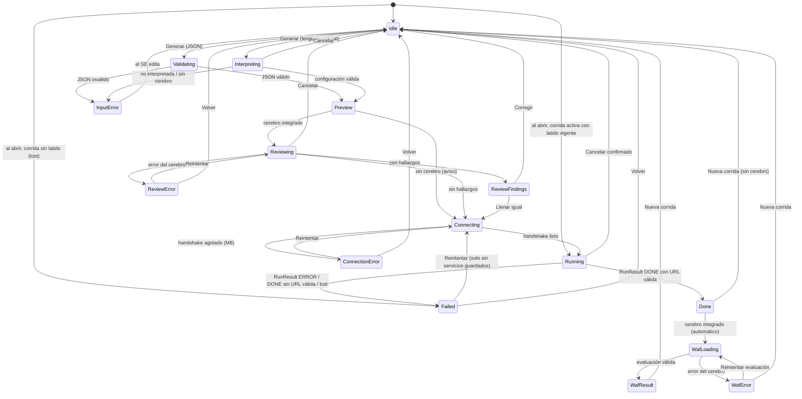

# Especificación funcional — u6-popup-ui

> Comportamiento del panel lateral de la extensión: estados, flujos,
> transiciones y textos. Adapta los mockups refinados (M1-M9) del popup al
> panel lateral (decisión de u1) y completa en sitio la máquina de estados
> provisional de u1 (`lib/panel/panel-state.js`) con los estados que trajeron
> u2-u5. Implementa US5.1 (presentación), US6.1, US6.2 y US6.3 de `stories.md`.
> Unidad de tipo `ui`: este archivo es la fuente de verdad de flujos, pantallas
> y textos; `rules.md` da las anclas de trazabilidad y `frontend-components.md`
> los componentes. Prosa en español; identificadores en inglés.

## Sources

- `aidlc/spaces/default/intents/260922-calculator-rpa/inception/user-stories/stories.md` (US5.1, US6.1-US6.3). [stories]
- `aidlc/spaces/default/intents/260922-calculator-rpa/inception/refined-mockups/` (mockups, interaction-spec, accessibility-checklist, design-system-mapping). [stage]
- `aidlc/spaces/default/intents/260922-calculator-rpa/inception/units-generation/unit-of-work.md` (U6). [stage]
- Diseños de u1 (estados del panel, latido, `lost`), u2, u4 y u5 (contratos que el panel muestra). [stage]
- `rules.md` y `functional-design-questions.md` (Q1-Q2) de esta unidad. [Q1-Q2]

## 1. Alcance

**Dentro:** `sidepanel.html` / `sidepanel.js` y `lib/panel/**` (incluido `panel-state.js`, que pasa de provisional a definitivo), los textos del panel (`lib/messages-es.js`), estados, pestañas, vista previa, revisión Well-Architected previa y final, conexión, progreso, resultado, reanudación, historial plegable, accesibilidad.

**Fuera:** normalizar (u2), mapear (u3), cerebro (u4), RPA (u5), escribir el registro técnico (u1).

## 2. Estados del panel

Texto equivalente:
- **Al abrir el panel.** Si hay una corrida activa con latido vigente, se reanuda en **Running** (`RESUME_ACTIVE` de u1). Si el latido venció, termina en **Failed** con `lost` (`RUN_LOST`). Si no hay corrida, empieza en **Idle**.
- **Validación e interpretación.** Desde **Idle**, "Generar" lleva a **Validating** (JSON) o a **Interpreting** (lenguaje natural). Ambos terminan en **Preview** o en **InputError**; **Interpreting** también puede volver a **Idle** con Cancelar.
- **Revisión Well-Architected previa.** **Preview** pasa a **Reviewing** si el cerebro está integrado, o a **Connecting** con aviso si no. **Reviewing** tiene Cancelar. Sin hallazgos va a **Connecting**; con hallazgos va a **ReviewFindings**, donde "Llenar igual" lleva a **Connecting** y "Corregir" a **Idle**. Si falla, va a **ReviewError**, que ofrece Reintentar o Volver.
- **Conexión.** **Connecting** hace el handshake de u1. Si se agota, va a **ConnectionError** (M8), que ofrece Reintentar o Volver.
- **Corrida.** **Running** termina en **Done** solo con DONE y una URL válida. Con ERROR, DONE sin URL válida o `lost`, termina en **Failed**. Un Cancelar confirmado vuelve a **Idle**.
- **Evaluación final.** **Done** lanza sola la evaluación final si el cerebro está integrado (**WafLoading**, que termina en **WafResult** o **WafError**, con reintento). Sin cerebro, **Done** ofrece "Nueva corrida".
- **Después de un fallo.** **Failed** ofrece "Volver" siempre. "Reintentar" (repite la misma configuración normalizada desde **Connecting**) solo aparece cuando no quedó ningún servicio guardado en el estimado (`failureStep` `connection` o `preconditions`) y la configuración sigue en memoria. Si hubo servicios guardados o se llegó a Failed al reabrir (`lost`), el panel indica abrir un estimado nuevo en calculator.aws y volver a generar.
- **Sesión y errores del cerebro (agregado en NFR Requirements).** Desde Interpreting, Reviewing o WafLoading, un error del cerebro lleva a InputError (Interpreting), ReviewError (Reviewing) o WafError (WafLoading) con el texto de la tabla "Errores del cerebro" de §6. Si el código es `unauthorized`, ese estado muestra además el botón "Iniciar sesión"; al pulsarlo, el panel pide el login al service worker y, si termina bien, vuelve al estado anterior a la llamada para reintentar; `login_cancelled` deja el mismo estado de error con su texto. Antes de pasar de Preview a Reviewing, si al token le quedan menos de 15 minutos, el panel muestra "Iniciar sesión" primero.
- **Topes de espera (agregado en NFR Requirements).** Reviewing y WafLoading tienen un tope de 35 s medido por el panel (30 s del service worker más margen); vencido, el panel despacha el evento `timeout` y pasa a ReviewError o WafError con el texto de `timeout`. Connecting usa el handshake de u1 (3 intentos de PING) y, si se agota, va a ConnectionError. WafLoading ofrece además Cancelar, que vuelve a Done sin evaluación.
- **Siempre.** Ninguna transición borra el texto de las pestañas, y la URL sigue visible en **WafLoading**, **WafResult** y **WafError**.

## 3. Contrato del reductor (`panel-state.js`, Zona A)

- `transition(state, event) → state` es pura. Un evento que no tiene transición desde el estado actual se ignora (el estado no cambia) y se cuenta para diagnóstico.
- El estado guarda `requestId` (la interpretación o revisión en curso) y `runId` (la corrida en curso). Cada evento asíncrono lleva su id; si no coincide con el vigente, se ignora. Así, una respuesta de `normalize` que llega tras Cancelar, o un `progress` o `run-result` de una corrida cancelada o anterior, nunca mueve el panel.
- Cancelar en Interpreting y Reviewing aborta la petición (señal) y borra `requestId`. Cancelar en Running pide confirmación, envía la cancelación al content script y pasa a Idle al recibir el `RunResult` de esa corrida (que se ignora como resultado) o tras 20 s.
- Durante Interpreting, Reviewing, Connecting y Running, la entrada y "Generar" quedan deshabilitados; el historial también (u1).
- El texto de cada pestaña se guarda en `chrome.storage.session` al cambiar, y sobrevive a cerrar y reabrir el panel durante la sesión del navegador.

## 4. Pantallas (mapeo a los mockups)

| Estado | Mockup base | Contenido |
|---|---|---|
| Idle | M1/M2 | Pestañas, cuadro de texto, "Generar Estimado"; aviso "sin revisión" si no hay cerebro; "Última corrida" e historial como secciones plegadas al pie (cerradas, sin mensajes visibles: AC6.3.1). |
| Validating / Interpreting | — | Indicador ("Validando…" / "Interpretando…"); Cancelar en Interpreting. |
| InputError | M3 | Mensaje de u2 y fragmentos no interpretados en lista, con el foco en el mensaje. |
| Preview | — | Servicios, plantilla, región y "(por defecto)". |
| Reviewing / ReviewFindings / ReviewError | base M7 | Hallazgos por servicio con pilar y severidad; "Llenar igual" / "Corregir"; error con Reintentar / Volver. |
| Connecting / ConnectionError | M8 | "Conectando con calculator.aws…"; error de u1 con Reintentar / Volver. |
| Running | M4 | "Servicio N de M", fila por servicio, paso actual y, en `asking_brain`, el tiempo transcurrido; Cancelar. |
| Done | M5 | Veredicto, URL copiable, lista por servicio, aviso de claves resueltas por el cerebro. |
| Failed | M6 | Sin URL; motivo global (§6) y lista por servicio con motivo, campo donde se detuvo y no intentados; Reintentar / Volver. |
| WafLoading / WafResult / WafError | M7 / M7-err | Agrupado por servicio, pilar y severidad; "Sin hallazgos" explícito; error con "Reintentar evaluación". La URL sigue arriba. |

## 5. Flujos

### P1 — Generar estimado

1. El SE elige pestaña y escribe; pulsa "Generar Estimado".
2. `normalize` (u2): JSON → Validating; lenguaje natural → Interpreting.
3. Error → InputError con el texto intacto.
4. Preview con la configuración normalizada.
5. Con cerebro: revisión previa (Reviewing); sin hallazgos sigue; con hallazgos decide el SE; error → ReviewError.
6. Connecting (handshake de u1) → Running.
7. Done → evaluación final automática si hay cerebro; Failed → Reintentar o Volver.

### P2 — Reabrir el panel

1. `resolveInitialView` (u1) lee `activeRun` y `lastRunResult`.
2. Corrida activa con latido → Running con sus eventos (`runId` de la corrida activa). Latido vencido → Failed con `lost`. Sin corrida → Idle.

### P3 — Historial

Sección plegable al pie, como en u1: lista, exportar, borrar una o todas; deshabilitada durante una corrida.

## 6. Textos

Todos viven en `lib/messages-es.js` y se prueban con Vitest. Ningún texto del cerebro o de la página se interpola sin pasar por texto plano.

| `ServiceResult.reason` | Texto |
|---|---|
| `service_not_found` | No encontré el servicio en el catálogo de la calculadora. |
| `template_not_found` | La calculadora no ofrece la plantilla pedida para este servicio. |
| `field_not_recognized` | Hay campos que no pude reconocer: {detalle}. |
| `field_not_resolved` | No pude ubicar el campo {campo} en la página. |
| `field_not_applied` | El campo {campo} no quedó con el valor pedido. |
| `option_no_match` | "{valor}" no es una opción del campo {campo}. |
| `toggle_not_applied` | No pude activar la opción {campo}. |
| `validation_required` | La calculadora pide completar un campo obligatorio: {campo}. |
| `save_not_confirmed` | No pude confirmar que el servicio se guardó. |
| `page_timeout` | La página tardó demasiado en responder. |
| `service_timeout` | El servicio superó los 3 minutos y se detuvo. |
| `not_attempted` | No se procesó porque la corrida se detuvo antes. |
| `unexpected_error` | Ocurrió un error inesperado en este servicio. |

| `RunResult.failureStep` (ERROR sin resultados por servicio) | Texto |
|---|---|
| `preconditions` | El estimado de calculator.aws no está vacío. Ábrelo en una pestaña nueva y vuelve a intentar. |
| `connection` | No pude conectar con calculator.aws. Recarga la pestaña y vuelve a intentar. |
| `lost` | La corrida dejó de responder. Revisa la pestaña de calculator.aws. |
| `estimate_check` | El estimado final no coincide con lo pedido. |
| `rename` | No pude renombrar el estimado. |
| `share` | No pude obtener el enlace público del estimado. |
| `services` | Algunos servicios no se completaron. |

Un `RunResult` DONE sin `estimateUrl` o con una URL que no es de calculator.aws se muestra como Failed con el texto de `share`; nunca como éxito.

| Errores del cerebro y de la sesión (`code`) | Texto |
|---|---|
| `unauthorized` | Tu sesión venció. Inicia sesión para continuar. |
| `login_cancelled` | No se completó el inicio de sesión. |
| `rate_limited` | Hay muchas solicitudes en curso. Espera unos segundos y vuelve a intentar. |
| `daily_quota_exceeded` | Alcanzaste el límite diario de uso del asistente. Podrás volver a usarlo mañana. |
| `inventory_unavailable` | El catálogo de la calculadora no está disponible en este momento. |
| `model_unavailable` / `brain_unavailable` | No pude conectar con el servicio de interpretación. Intenta más tarde. |
| `timeout` | El servicio de interpretación tardó demasiado en responder. |
| `bad_request` / `empty_result` / `internal_error` | El servicio de interpretación no pudo procesar la solicitud. |
| `input_limit_exceeded` | La configuración supera el límite de {límite}. |

Valores desconocidos (un `reason`, `step` o pilar que no está en las tablas) se muestran con un texto de respaldo: "Ocurrió un problema ({código})." para motivos y "Trabajando…" para pasos. `{servicio}` viene de `ServiceRequest.serviceName`; `{campo}` y `{valor}` de `ServiceResult.stoppedAtLabel` y `detail`; `{detalle}` de `detail`. Todo se inserta como texto plano.

"Última corrida" (sección plegada en Idle) muestra fecha, veredicto y URL si fue DONE; no muestra mensajes de error abiertos, para respetar AC6.3.1.

| `ProgressEvent.step` | Texto |
|---|---|
| `adding_service` | Agregando {servicio} |
| `applying_toggles` | Ajustando opciones de {servicio} |
| `mapping_pass` | Llenando campos de {servicio} |
| `asking_brain` | Consultando el mapeo de {servicio} ({segundos} s) |
| `applying_action` | Llenando {campo} |
| `saving` | Guardando {servicio} |
| `cancelling` | Saliendo sin guardar de {servicio} |
| `checking_estimate` | Revisando el estimado |
| `renaming` | Renombrando el estimado |
| `sharing` | Obteniendo el enlace público |

| Pilar (u4) | Etiqueta | | Severidad | Etiqueta |
|---|---|---|---|---|
| OperationalExcellence | Excelencia operativa | | high | Alta |
| Security | Seguridad | | medium | Media |
| Reliability | Fiabilidad | | low | Baja |
| PerformanceEfficiency | Eficiencia de rendimiento | | | |
| CostOptimization | Optimización de costos | | | |
| Sustainability | Sostenibilidad | | | |

## 7. Accesibilidad

`lang="es"` en el documento; pestañas con `tablist`/`tab`/`tabpanel` y flechas; Escape cancela en Interpreting, Reviewing y en el diálogo de confirmar Cancelar; al entrar a InputError, ReviewError, ConnectionError, Failed y WafError el foco va al mensaje, que tiene `role="alert"`; el progreso por servicio se anuncia en `aria-live="polite"` (sin anunciar cada acción); objetivos táctiles de 44 px; el panel funciona desde 320 px de ancho sin desplazamiento horizontal; contraste AA.

## 8. Impacto en otras unidades

- **u2:** `normalize({format, text}, {interpretNaturalLanguage, signal})` asíncrono; el panel crea la señal y descarta el resultado `cancelled`; muestra `input_limit_exceeded` con el límite que nombra u2.
- **u4:** `/waf-evaluate` con `phase` y `severity`; errores visibles.
- **u5:** `RunResult` con `runId`, `missing`, `stoppedAtLabel`, `not_attempted`, `brainSubstitutions` como `{key, requestedValue, appliedValue}`; `ProgressEvent` con `runId`; respuesta a la cancelación.

## 9. Verificación

Zona A: `panel-state.js` (todas las transiciones de §2, eventos ignorados por id o por estado), `resolveInitialView` y `messages-es.js` (todas las tablas de §6) con Vitest. Zona B: render, foco, `aria-live`, contraste y reflow en el smoke del panel.
