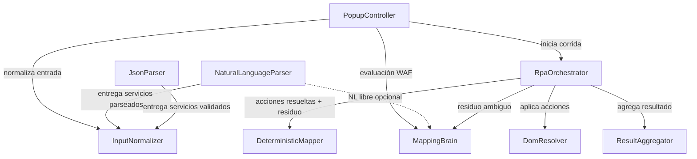

# Catálogo de componentes — Revivida de la extensión RPA AWS Pricing Calculator

> Bloques lógicos de código (no topología de despliegue — eso es Units Generation).
> El bloque YAML es la fuente de verdad; las tablas y el diagrama se derivan de él.
> Prosa en español; nombres de componente/entidad e identificadores en inglés.

## Sources

- `aidlc/spaces/default/intents/260922-calculator-rpa/inception/requirements-analysis/requirements.md` (FR1-FR11, NFR1-NFR8). [requirements]
- `aidlc/spaces/default/intents/260922-calculator-rpa/inception/user-stories/stories.md` (US1.0-US8.1). [stories]
- `aidlc/spaces/default/codekb/extension/architecture.md`, `component-inventory.md`. [brownfield]
- Decisiones de diseño Q1-Q3 (hogar del cerebro híbrido; dos parsers; RPA/DOM separados). [decidido]

## Parte A — Catálogo (fuente de verdad)

```yaml
components:
  - name: PopupController
    summary: Controlador de la UI del popup (entrada, progreso, resumen, navegación a WAF).
    behaviour: >
      Orquesta el flujo del popup: pestañas NL/JSON, acción "Generar Estimado",
      render del progreso por servicio y del resumen todo-o-nada, navegación a la
      vista Well-Architected. Envía la entrada al InputNormalizer y los mensajes de
      control (RUN_RPA, PING) al content script; recibe resultados tipados por
      servicio y los muestra. No contiene lógica de mapeo ni de DOM.
    responsibilities:
      - Render de los estados del popup (M1-M8) y copy en español
      - Disparar la corrida y la evaluación WAF on-demand
      - Mostrar resultados tipados por servicio (nunca reportar éxito en fallo)
    depends_on:
      - component: InputNormalizer
        interaction: normaliza la entrada (NL o JSON) a la estructura interna antes de correr
        style: sync
      - component: RpaOrchestrator
        interaction: inicia la corrida y recibe progreso/resultado por servicio
        style: async
      - component: MappingBrain
        interaction: solicita la evaluación Well-Architected sobre el estimado construido
        style: async
    dependents: []
    entities: []

  - name: NaturalLanguageParser
    summary: Interpreta una expresión en lenguaje natural a una lista de servicios solicitados.
    behaviour: >
      Parsea texto libre que nombra servicios AWS y configuraciones. Resuelve lo
      que puede de forma determinística; cuando la expresión excede su capacidad,
      devuelve un error tipado que nombra el fragmento no interpretado (no llena
      nada parcial). Puede apoyarse en el MappingBrain para expresiones libres
      complejas (frontera que se afina en Functional Design).
    responsibilities:
      - Parseo NL → servicios solicitados (estructura cruda)
      - Error tipado con el fragmento no interpretado
    depends_on:
      - component: InputNormalizer
        interaction: entrega los servicios parseados para normalizar
        style: sync
      - component: MappingBrain
        interaction: (opcional) interpretar expresiones NL libres que exceden el parseo local
        style: async
    dependents: []
    entities: []

  - name: JsonParser
    summary: Valida y parsea el JSON de entrada contra el esquema del Anexo A.
    behaviour: >
      JSON.parse + validación de forma: services presente y no vacío, cada servicio
      con name/search_term, fields como objeto. Error tipado y específico en cada
      fallo (sintáctico, sin services, no conforme al esquema). Determinístico, sin
      red ni FM.
    responsibilities:
      - Validación sintáctica y de esquema del JSON de entrada
      - Error tipado por caso (inválido / sin services / no conforme)
    depends_on:
      - component: InputNormalizer
        interaction: entrega los servicios validados para normalizar
        style: sync
    dependents: []
    entities: []

  - name: InputNormalizer
    summary: Unifica la salida de los parsers en la estructura interna de servicios solicitados.
    behaviour: >
      Recibe servicios de NaturalLanguageParser o JsonParser y produce la misma
      estructura interna normalizada (ServiceRequest), independiente del formato de
      origen. Determinístico, Zona A, unit-testeable.
    responsibilities:
      - Normalizar NL/JSON → estructura interna común
      - Garantizar que ambos formatos convergen en la misma forma
    depends_on: []
    dependents:
      - component: NaturalLanguageParser
        interaction: recibe los servicios parseados desde NL para normalizar
      - component: JsonParser
        interaction: recibe los servicios validados del JSON para normalizar
      - component: PopupController
        interaction: el controlador consume la estructura normalizada lista para correr
    entities:
      - name: ServiceRequest
        identifier: requestId
        attributes: [requestId, serviceName, searchTerm, template, region, fields, toggles]
        references: []

  - name: DeterministicMapper
    summary: Mapea valores solicitados a campos escaneados cuando el match es inequívoco, sin FM.
    behaviour: >
      Dado el DOM escaneado (campos/labels) y los valores solicitados, resuelve los
      mapeos obvios: match exacto o normalizado de label, y valores directos del
      JSON. Produce acciones (fill/select/toggle/...) para lo resuelto y marca como
      "residuo ambiguo" lo que no pudo mapear con certeza. Función pura, Zona A,
      unit-testeable. Minimiza las llamadas al FM (eficiencia de tokens).
    responsibilities:
      - Resolver mapeos campo↔valor inequívocos sin LLM
      - Separar lo resuelto del residuo ambiguo que requiere razonamiento
    depends_on: []
    dependents:
      - component: RpaOrchestrator
        interaction: entrega las acciones resueltas y el residuo ambiguo
    entities:
      - name: MappingAction
        identifier: actionId
        attributes: [actionId, fieldLabel, actionType, value, source]
        references: []

  - name: MappingBrain
    summary: Razonamiento del FM (server-side) sobre el residuo ambiguo de mapeo y sobre el Well-Architected.
    behaviour: >
      Endpoint server-side que guarda la credencial del FM (regla dura: nunca en el
      cliente). Recibe DATA estructurada (campos escaneados + valores no resueltos)
      y devuelve acciones de mapeo para el residuo ambiguo; y, por separado, recibe
      el estimado construido y devuelve recomendaciones Well-Architected clasificadas
      por pilar. NUNCA recibe screenshots — razona sobre texto/datos, no pixeles
      (eficiencia de tokens). Su alojamiento concreto (recrear n8n desde backup vs.
      agente Bedrock nuevo) se decide en Contract/Infrastructure Design; aquí es una
      frontera con interfaz estable.
    responsibilities:
      - Mapeo del residuo ambiguo vía FM, sobre datos escaneados
      - Evaluación Well-Architected (FR8) vía FM
      - Custodiar la credencial del FM server-side
    depends_on: []
    dependents:
      - component: RpaOrchestrator
        interaction: resuelve el residuo de mapeo que el DeterministicMapper no pudo
      - component: NaturalLanguageParser
        interaction: (opcional) interpretar expresiones NL libres
      - component: PopupController
        interaction: evaluación Well-Architected on-demand
    external_dependencies:
      - name: Foundation Model (Claude / Amazon Bedrock)
        kind: third-party-api
        purpose: razonamiento de mapeo del residuo ambiguo y recomendaciones Well-Architected
    entities:
      - name: WafRecommendation
        identifier: recommendationId
        attributes: [recommendationId, serviceName, pillar, text]
        references: []

  - name: RpaOrchestrator
    summary: Orquesta el flujo por servicio y agrega el resultado; lógica de control (Zona A).
    behaviour: >
      Por cada servicio: pide al DeterministicMapper las acciones resueltas, envía el
      residuo ambiguo al MappingBrain, y manda las acciones al DomResolver para
      aplicarlas. Controla reintentos acotados (NFR8), recoge el resultado tipado de
      cada servicio y delega la agregación todo-o-nada al ResultAggregator. No toca
      el DOM directamente.
    responsibilities:
      - Flujo por servicio (add → configurar → mapear → aplicar → guardar → confirmar)
      - Reintentos acotados con resultado tipado de error (terminación observable)
      - Coordinar DeterministicMapper, MappingBrain y DomResolver
    depends_on:
      - component: DeterministicMapper
        interaction: obtiene las acciones resueltas y el residuo ambiguo
        style: sync
      - component: MappingBrain
        interaction: resuelve el residuo ambiguo de mapeo
        style: async
      - component: DomResolver
        interaction: aplica las acciones y confirma el guardado sobre el DOM
        style: sync
      - component: ResultAggregator
        interaction: agrega el resultado por servicio y decide todo-o-nada
        style: sync
    dependents:
      - component: PopupController
        interaction: recibe progreso y resultado de la corrida
    entities: []

  - name: DomResolver
    summary: Escaneo y resolución resiliente del DOM CloudScape; aplica acciones (Zona B).
    behaviour: >
      scanForm enumera todos los tipos de campo (inputs, selects, dropdowns
      CloudScape, radios, radiogroups, sliders, toggles, instance tables) y resuelve
      label/section. resolveElementByLabel usa estrategias en cascada (aria-label →
      aria-labelledby → label[for] → sección). executeActions aplica fill/select/
      dropdown/radio/toggle. Confirma guardado SOLO por el banner verde
      `Successfully added <Service> estimate.` y detecta `is required`. Incluye los
      FIX-1..FIX-9. Dibuja y limpia el overlay spotlight, excluyendo sus nodos del
      escaneo. Dependiente del DOM de terceros (Zona B, smoke manual).
    responsibilities:
      - Escaneo determinístico del DOM → data estructurada
      - Resolución resiliente de elementos y aplicación de acciones
      - Confirmación de guardado por señal positiva; detección de validación
      - Overlay spotlight (dibujar/limpiar, no interferir)
    depends_on: []
    dependents:
      - component: RpaOrchestrator
        interaction: provee el DOM escaneado y aplica las acciones
    external_dependencies:
      - name: calculator.aws DOM (CloudScape)
        kind: third-party-api
        purpose: superficie objetivo del RPA (sitio de terceros, sin API)
    entities: []

  - name: ResultAggregator
    summary: Agregación todo-o-nada del resultado de la corrida (función pura, Zona A).
    behaviour: >
      Compara el conjunto de servicios solicitados con el conjunto de servicios
      confirmados por el banner verde. Devuelve URL si y solo si confirmados ⊇
      solicitados; si falta ≥1, devuelve fallo con la lista de faltantes y su motivo.
      Nunca reporta éxito en un fallo (ancla la compuerta P3). Función pura,
      unit-testeable. Construye y posee el RunResult; PopupController lo consume
      para el render.
    responsibilities:
      - Decisión todo-o-nada (DONE/ERROR, sin PARTIAL; cambio de Functional Design 2026-11-21) por inclusión de conjuntos
      - Construir el RunResult (dueño) y la lista de ServiceResult por servicio
    depends_on: []
    dependents:
      - component: RpaOrchestrator
        interaction: recibe los resultados por servicio y devuelve el veredicto global
    entities:
      - name: ServiceResult
        identifier: requestId
        attributes: [requestId, serviceName, status, reason, detail, stoppedAtLabel, brainSubstitutions, durationMs]
        references:
          - entity: ServiceRequest
            owned_by: InputNormalizer
            relationship: cada ServiceResult corresponde a un ServiceRequest solicitado
      - name: RunResult
        identifier: runId
        attributes: [runId, status, estimateUrl, perServiceResults]
        references:
          - entity: ServiceResult
            owned_by: ResultAggregator
            relationship: cada RunResult agrega uno o más ServiceResult
```

## Parte B — Vista humana

### Diagrama de componentes



> Dirección de llamada en el borde de entrada: los parsers (`NaturalLanguageParser`,
> `JsonParser`) **llaman a** `InputNormalizer` entregándole sus servicios; por eso
> `InputNormalizer` los lista en `dependents` y cada parser lo lista en `depends_on`.

### Resumen de componentes

| Component | Purpose | Depends On | Dependents | Entities Owned |
|---|---|---|---|---|
| PopupController | Controlador del popup (UI) | InputNormalizer, RpaOrchestrator, MappingBrain | — | — |
| NaturalLanguageParser | Parseo NL → servicios | InputNormalizer, MappingBrain (opcional) | — | — |
| JsonParser | Validación del JSON de entrada | InputNormalizer | — | — |
| InputNormalizer | Estructura interna normalizada | — | NaturalLanguageParser, JsonParser, PopupController | ServiceRequest |
| DeterministicMapper | Mapeo obvio sin FM (Zona A) | — | RpaOrchestrator | MappingAction |
| MappingBrain | FM server-side: residuo + WAF | — | RpaOrchestrator, NaturalLanguageParser, PopupController | WafRecommendation |
| RpaOrchestrator | Flujo por servicio (Zona A) | DeterministicMapper, MappingBrain, DomResolver, ResultAggregator | PopupController | — |
| DomResolver | Escaneo/resolución DOM (Zona B) | — | RpaOrchestrator | — |
| ResultAggregator | Agregación todo-o-nada (Zona A) | — | RpaOrchestrator | ServiceResult, RunResult |

### Ownership de entidades

| Entity | Owning Component | Identifier | Attributes | References |
|---|---|---|---|---|
| ServiceRequest | InputNormalizer | requestId | requestId, serviceName, searchTerm, template, region, fields, toggles | — |
| MappingAction | DeterministicMapper | actionId | actionId, fieldLabel, actionType, value, source | — |
| WafRecommendation | MappingBrain | recommendationId | recommendationId, serviceName, pillar, text | — |
| ServiceResult | ResultAggregator | requestId | requestId, serviceName, status, reason, detail, stoppedAtLabel, brainSubstitutions, durationMs | ServiceRequest (InputNormalizer) |
| RunResult | ResultAggregator | runId | runId, status, estimateUrl, perServiceResults | ServiceResult (ResultAggregator) |

> `ResultAggregator` construye y posee `RunResult` (el veredicto todo-o-nada);
> `PopupController` lo consume para el render, no lo posee.

### Dependencias externas

| Component | Dependency | Kind | Purpose |
|---|---|---|---|
| MappingBrain | Foundation Model (Claude / Amazon Bedrock) | third-party-api | razonamiento de mapeo del residuo + Well-Architected |
| DomResolver | calculator.aws DOM (CloudScape) | third-party-api | superficie objetivo del RPA |

### Rationale

| Component | Por qué es un bloque separado |
|---|---|
| PopupController | Distinto concern (UI/control) y distinto tiempo de vida que la lógica de mapeo/DOM |
| NaturalLanguageParser | Concern y tasa de cambio propios (razonamiento NL, posible apoyo del FM) |
| JsonParser | Validación determinística aislada; unit-testeable sin red |
| InputNormalizer | Punto único de convergencia; desacopla el resto del formato de entrada |
| DeterministicMapper | Lógica pura de mapeo obvio; su separación del FM es el corazón de la eficiencia de tokens |
| MappingBrain | Única frontera con el FM y con la credencial server-side; distinto alojamiento y distinto riesgo |
| RpaOrchestrator | Control de flujo puro (Zona A); separable del DOM para testear la orquestación |
| DomResolver | Único componente acoplado al DOM de terceros (Zona B); aísla el riesgo P2 |
| ResultAggregator | Función pura que ancla la compuerta P3; unit-testeable de forma aislada |

**Alternatives Rejected (resumen; detalle en `decisions.md`):**
- Cerebro 100% local sin FM — rechazado: el WAF (FR8) necesita un LLM.
- Cerebro 100% en el FM (todo el mapeo vía LLM) — rechazado: quema tokens innecesariamente; el DeterministicMapper resuelve lo obvio primero.
- Un solo componente RPA (orquestación + DOM) — rechazado: mezcla Zona A testeable con Zona B dependiente del DOM.
- Un solo componente de entrada — rechazado: NL y JSON tienen razonamiento y tasa de cambio distintos.
